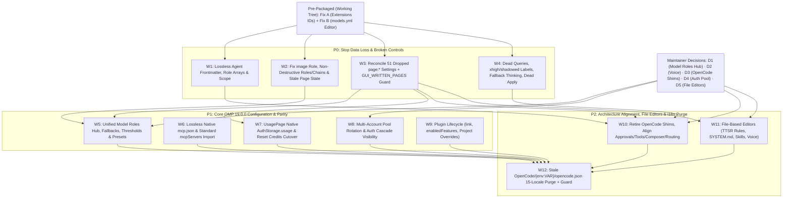

# OMP 19.0.0 Alignment Remediation Plan

- **Date:** 2026-11-23
- **Research base:** `19613812d5`
- **Research pin:** OMP `19.0.0` (`vendor/omp/57771ae5`)

This research snapshot predates OMP 19.1.0 and OpenChamber v2.8.0. Verify each
workstream against the current `main`, the pinned SDK, and their existing
Canonical routes before implementing it. The metrics below describe the
research base, not current settings coverage.

## 1. Metadata & Executive Overview

OhPiChamber migrated to OMP `19.0.0` across M0–M4 and M6, but cross-layer drifts remain between OMP's live runtime registry/files and the Canonical Contract, Agent Service projections, Host Gateway routes, and Settings/Chat UI.

### Baseline Metrics (`19613812d5`)

| Metric | Verified Value | Source |
|---|---|---|
| Registered built-in OMP 19.0.0 settings (`orderedSettings()`) | **638** (+1 worker-registered `suggestion.generator`) | `all-settings.ts`, `packages/agent-service/src/worker/suggestion.ts:14` |
| `RAW_PLACEMENTS` entries in `settings-ui.ts` | **484** (480 live built-ins + 1 worker `suggestion.generator` + 3 stale IDs) | `packages/agent-service/src/worker/settings-ui.ts:23-564` |
| Exposed via `OMP_SETTING_EXPOSED_IDS` | **261** (`169` `page` + `86` `engine` + `6` `owned-by` across `5` `OMP_SETTING_OWNER_IDS`) | `packages/agent-service/src/worker/settings-ui.ts:581-646` |
| Live `page:*` settings silently dropped by `GUI_WRITTEN_PAGES` | **51** across 8 unrendered page keys (`git`, `notifications`, `general`, `providers`, `web-search`, `voice`, `usage`, `commands`) | `packages/agent-service/src/worker/settings-ui.ts:581-588,624` |
| Stale `RAW_PLACEMENTS` IDs absent from `orderedSettings()` | **4** (`task.file`, `codexResets.autoRedeem`, `claudeResets.autoRedeem`, plus worker-side `suggestion.generator`) | `packages/agent-service/src/worker/settings-ui.ts:389,447,451,563` |
| Non-GUI placement totals in `RAW_PLACEMENTS` | `84` `tui-only`, `58` `boundary`, `27` `config-only` | `packages/agent-service/src/worker/settings-ui.ts:23-564` |
| Unplaced built-in OMP 19.0.0 settings (`638 - 480`) | **158** (`auth.broker.*`, `compaction.modelThresholds`, `compaction.modelThresholdsEnabled`, `compaction.reserveTokens`, `compaction.keepRecentTokens`, `compaction.autoContinue`, `modelTags`, `modelProviderOrder`, `thinkingBudgets.*`, `memories.*`, `skills.enabled`, `skills.enable*`, `commit.*`, etc.) | `all-settings.ts` vs. `settings-ui.ts` |
| Built-in `MODEL_ROLES` in OMP 19.0.0 | **16** (`11` chat + `5` kind roles); only **9** have `<ModelRoleEditor>` instances (**1** broken: `image`) | `model-roles.ts:56-91`; `DefaultsSettings.tsx`, `GitSettings.tsx`, `AgentsPage.tsx`, `MemoryPage.tsx`, `ToolsPage.tsx` |

### Already Completed in Prior Commits on This Branch

Two P0/P1 defects are already implemented on top of `19613812d5` and must be preserved when branching or implementing workstreams W1–W12:

| Fix | Scope & Changed Files | Verified Implementation & Evidence |
|---|---|---|
| **Fix A: OMP Extensions Duplicate Row Identity** | `packages/agent-service/src/worker/catalog-extensions.ts:90-104,173-201`; `packages/agent-service/src/worker/catalog-extensions.test.ts:1-270` | Replaced the collision-prone identity hash with `itemIdentityBase(kind, nativeId, key, name, source, itemPath)` + per-collect `seenBaseIds` occurrence counter (`itemIdentity(baseIdentity, occurrence)`). Prevents React duplicate-key collisions for multi-host `ssh-config`/`ssh-json`, cross-scope `cwd === home`, and duplicate `settings.json` entries. Verified: 10/10 unit tests in `catalog-extensions.test.ts` and live 81/81 unique IDs. |
| **Fix B: Full OMP 19.0.0 `models.yml` Provider & Override Editor** | `packages/agent-contract/src/omp-provider-config.ts`; `provider-management.ts`; `catalogs.ts`; `index.ts`; `packages/agent-service/src/worker/catalog-models.ts:740-1664`; `catalog-model-info.ts`; `workspace-routes.ts`; `packages/ui/src/api/canonicalClient.ts`; `CustomProviderForm.tsx:1-1377`; `CustomProviderModelRow.tsx:1-1014`; `OmpProviderSubforms.tsx:1-355`; `custom-provider-form.ts:1-1536`; `ProvidersPage.tsx:1-1073`; `omp-provider-config.i18n.ts`; `providers.i18n.ts`; `canonical-host-routes.test.js`; `sections/DOCUMENTATION.md` | Full lossless CRUD over `models.yml`: all 16 `OMP_PROVIDER_APIS` + 8 `OMP_RUNNER_APIS`, `modelOverrides` patching without copying built-in catalogs, per-model `thinking` (`mode`, `efforts`, `defaultLevel`, `effortBudgets`, `effortRouting`, `requiresEffort`, `supportsDisplay`), pricing/cache rates, Bedrock guardrails, remote compaction, runtime discovery, `configApiKey` (`OPENAI_API_KEY`, `!cmd`, literal) and header patching. Verified: lossless `CLIProxyAPI` 18-model / 4-protocol round-trip, HappyDOM `en`/`zh-CN` form tests, enterprise-mode 403 enforcement, `type-check`, `oxlint`, and `dead-code`. |

---

## 2. Governance, Prior Decisions & Automated Guardrails

### Binding Decisions & Spec Constraints

Every workstream must comply with, or explicitly trigger a maintainer decision to amend, the following entries in `.workflow/decisions.md` and `.workflow/omp-migration/scope.md`:

| Source & Entry | Constraint Imposed on This Plan | Impacted Workstreams |
|---|---|---|
| `.workflow/decisions.md` (`2026-11-05` — *Fix auto routing effort mapping and unify small-model resolution on OMP modelRoles*) | Retire legacy `smallModel` / `smallModelRequest` / `walkthroughModelOverride` shims; resolve helper models via OMP `modelRoles` (`commit`, `smol`, `slow`, falling back to `default`). | W2, W5, W10 |
| `.workflow/decisions.md` (`2026-11-05` — *Retire BehaviorPage response-style injection, dead Code Mode toggle, and Host permission auto-accept*) | Host-side permission auto-accept is retired; Behavior/prompt rules live on disk (`AGENTS.md` / `.omp/rules/`). Note: `PermissionDefaultModeField.tsx` and `BehaviorPage.tsx` (`responseStylePreset`) later re-entered via M6 UX restoration and must be audited cleanly against OMP native controls. | W10, W11 |
| `.workflow/decisions.md` (`2026-11-10` — *Merge upstream OpenChamber with a real git merge*) | Upstream UI features are retained where compatible, resolved in favor of the OMP boundary where runtime authority diverges. | W10, W11, W12 |
| `.workflow/decisions.md` (`2026-11-10` — *OMP TUI parity means function and display parity, not a mirror of OMP's settings and commands*) | Do not clone OMP's raw TUI tables; surface GUI-actionable concepts in OpenChamber UI idioms (`PATTERNS.md`, `STYLING.md`). | W3, W5, W10, W11 |
| `.workflow/decisions.md` (`2026-11-12` — *Classify every OMP setting by GUI surface and let one role editor own model assignment*) | Every TUI-visible OMP setting must be explicitly classified (`page`, `engine`, `owned-by`, `tui-only`, `boundary`, `config-only`); `ModelRoleEditor` is the single role editor primitive. **Revisit via D1** for central **Model Roles** hub vs. distributed editors. | W2, W3, W5 |
| `.workflow/decisions.md` (`2026-11-13` — *The Usage page is an OMP-native dashboard*) | Usage page reads OMP's native `stats.db` (`getUsageStats`), `authStorage.usage`, and `getSessionUsage` across all OMP sessions (CLI + GUI). **Execute W7** to retire duplicate Host `/api/quota/*` scrapers. | W3, W7 |
| `.workflow/decisions.md` (`2026-11-14` — *The OMP route exposes only the settings a GUI owner draws or writes*) | `OMP_SETTING_EXPOSED_IDS` must fail closed: no exposed `page:*` ID may lack a live GUI control, and no `tui-only` / `boundary` / `config-only` setting is writable via `/api/agent/v1/workspaces/:id/omp-settings`. | W3, W5, W11 |
| `.workflow/decisions.md` (`2026-11-15` / `2026-11-18` — *Routing categories* & *Provider IDs follow OMP's selector grammar*) | Custom provider IDs use `[A-Za-z0-9._-]+` (up to 128 chars); routing categories validate in one shared config store and filter `openchamber/auto` via server readiness. **Revisit via D3** for `RoutingPage` `variant` vs. `thinking` alignment. | W8, W10 |
| `.workflow/decisions.md` (`2026-11-22` — *Empty custom reasoning options inherit the native catalog ladder*) | Never fabricate or erase reasoning options when custom provider row reasoning options are empty; Fix B enforces this. | Fix B, W8 |
| `.workflow/omp-migration/scope.md` (`SCOPE-5.2`, `SCOPE-10.5`, `SCOPE-13.2`–`13.5`, `SCOPE-14.3`, `SCOPE-14.5`) | `SCOPE-5.2` retains Slash Commands and Snippets; `SCOPE-10.5` governs Model and Intent Routing (`openchamber/auto`); `SCOPE-13.2` retains Provider and Model Registry; `SCOPE-13.3` governs Agent Profile Configuration; `SCOPE-13.4` retains Model Context Protocol (MCP); `SCOPE-13.5` governs Skills Management and Execution; `SCOPE-14.3` governs Quota and Usage Tracking (OMP `AuthStorage` credentials + `UsageStatsView`); `SCOPE-14.5` retains Voice Services (TTS / STT). | W6, W7, W8, W9, W10, W11 |
| `.workflow/specs/m6-audit-and-polish.md:94` | Standing exclusions (`PermissionDefaultModeField`, `SessionGoalCheckerField`, OpenCode-only composer root `agent` selector `CP-01`, `opencodeCli` config, `openCodeGo`) drifted back into `DefaultsSettings.tsx` / `en.settings.ts`. Must be resolved under D3 / W10 / W12. | W10, W12 |

### Automated Guardrails Every Task Must Preserve or Strengthen

1. **`packages/ui/src/components/sections/settingsItemOwnership.test.ts`** — enforces one `settingsItem` per page across `packages/ui/src/components/sections/**/*.tsx`, governs `SAME_PAGE_CLAIMS` (`lines 23-32`), and cross-checks `RAW_PLACEMENTS` (`owned-by <owner>`) against live UI `settingsItem` attributes.
2. **`packages/agent-service/src/worker/settings-ui.test.ts`** — enforces:
   - `orderedSettings()` TUI-visible placement completeness (`477` settings at `lines 31-50`),
   - exact `OMP_SETTING_OWNER_IDS` (`lines 59-63`),
   - `renderedSections(page)` fail-closed rendering check (`lines 209-240, 411-423` — currently bypasses unrendered pages via `GUI_WRITTEN_PAGES`, which **W3 fixes**),
   - 15-locale `settings.omp.items.<id>.(label|description|options.*)` completeness and anti-untranslated check (`lines 275-367`),
   - drawability check ensuring `page`/`engine` placements are primitives or have declared choices (`lines 381-397`).
3. **`packages/ui/src/components/sections/openchamber/ompSettingsLayout.test.ts`** — asserts exact 1:1 bijective parity between `OMP_SETTINGS_LAYOUT` (4 tabs: `common`, `editing`, `execution`, `advanced`) and `'engine'` entries in `RAW_PLACEMENTS` (`86` IDs at `line 75`), 15-locale group/tab/item copy, and `SETTINGS_SEARCH_ITEMS` sync (`packages/ui/src/lib/settings/search.ts`).
4. **`packages/ui/src/components/sections/settingsLayoutGuard.test.ts`** — AST/JSX scan enforcing rules `W` (no raw widths outside `SettingsSection.tsx` named constants), `S` (no `space-y-*` wrapper around `SettingsSection`), `P` (page padding owned by `SettingsPageLayout`), `B` (container queries `@xl:`/`@3xl:`, no viewport breakpoints `sm:`/`md:`/`lg:`/`xl:`/`2xl:`), `N` (`SETTINGS_WIDTH_NUMBER_CLASS` inside `SETTINGS_NUMBER_STEPPER_ROW_CLASS`), and `G` (named spacing scale).
5. **`packages/ui/src/components/sections/settingsDescriptionPolicy.test.ts`** — enforces `info` tooltip vs. visible `description` policy (`PATTERNS.md` items 5d & 9).
6. **`packages/ui/src/lib/i18n/messages.test.ts`** — enforces 15-locale key parity (`en`, `de`, `fr`, `nl`, `es`, `ja`, `pt-BR`, `uk`, `ko`, `pl`, `zh-CN`, `zh-TW`, `tr`, `ar`, `he`), placeholder preservation (`{provider}`, `{...}`), and translated OMP section descriptions (`lines 134-267`).
7. **Workspace gates** — `bun run check` (type-check + lint + tests), `bunx oxlint <changed-paths>` (rejects `anti-slop` low-evidence typing: `as`, `unknown`/`object`/`Record<string, unknown>`, ad-hoc `typeof`, module mocking), and `bun run dead-code`.

---

## 3. Maintainer Decisions Required

Before breaking P1/P2 workstreams (`W5`, `W8`, `W10`, `W11`) into `flow-break` tasks, resolve these five product/architecture choices:

### D1 — Unified OMP Model Roles & Fallbacks Hub vs. Distributed Per-Page Role Pickers

- **Context:** OMP 19.0.0 defines **16 built-in roles** (`default`, `smol`, `slow`, `vision`, `plan`, `commit`, `tiny`, `memory`, `task`, `advisor`, `widget`, `image`, `web`, `speech`, `dictation`, `judge` in `model-roles.ts:56-91`) plus custom roles via `modelTags`, ordered cycle carousel (`cycleOrder`), saved presets (`modelPresets`), per-role/per-model fallback chains (`retry.fallbackChains`), and per-model compaction thresholds (`compaction.modelThresholds`). Currently, 9 `<ModelRoleEditor>` instances are scattered across 5 pages (`DefaultsSettings.tsx`, `GitSettings.tsx`, `AgentsPage.tsx`, `MemoryPage.tsx`, `ToolsPage.tsx`), 7 built-in roles (`vision`, `tiny`, `widget`, `web`, `speech`, `dictation`, `judge`) have zero GUI, and `settingsItemOwnership.test.ts` forbids claiming the same `settingsItem` on two pages.
- **Options:**
  - *Option A (Unified Model Roles Hub + Cross-Links):* Create one authoritative **Model Roles** Settings page (or dedicated section under `Models & Roles` / `Sessions`) that owns `omp.modelRoles`, all 16 built-in + custom `modelTags` roles, `retry.fallbackChains`, `compaction.modelThresholds`, `cycleOrder`, and `modelPresets`. Keep read-only summary badges + deep-link buttons on Defaults, Git, Agents, Memory, and Tools (`requestSettingsJump(...)`).
  - *Option B (Distributed Pickers):* Keep existing 9 role editors on concept pages and add the missing 7 + fallback chain editors onto Tools/WebSearch/Voice/Defaults/Agents separately.
- **Recommended Pick:** **Option A.** OMP treats `modelRoles`, `cycleOrder`, `modelPresets`, and `retry.fallbackChains` as one interconnected routing graph (roles reference `@role` selectors and `modelTags`). Option A satisfies `settingsItemOwnership.test.ts` with zero `SAME_PAGE_CLAIMS` hacks, eliminates 4 duplicated `modelRoles` PATCH handlers (`DefaultsSettings`, `MemoryPage`, `ToolsPage`, `AgentsPage`), and mirrors OMP `/model` + `Models -> Roles` parity cleanly.
- **Decisions to Update:** Amend `.workflow/decisions.md` (`2026-11-10` & `2026-11-12` role-assignment notes).

### D2 — Voice Stack Unification (`VoiceSettings` Host `/api/tts` + `/api/dictation` vs. OMP `modelRoles.speech`/`dictation` + `speech.*`/`stt.*`)

- **Context:** `VoiceSettings.tsx` configures OpenChamber's Host voice routes (`/api/voice/keys`, `/api/tts`, `/api/dictation`, browser SpeechSynthesis, local ONNX/Kokoro), while `settings-ui.ts:455-463,165-166` places 11 OMP voice settings (`live.voice`, `tts.localVoice`, `tts.localSpeed`, `speech.enabled`, `speech.mode`, `speech.enhanced`, `speech.voice`, `speech.speed`, `providers.fetch`, `stt.enabled`, `stt.submitTrigger`) on `voice:*`, which `GUI_WRITTEN_PAGES` silently drops! Furthermore, OMP has `modelRoles.speech` (`accepts: kind === 'tts'`) and `modelRoles.dictation` (`accepts: kind === 'stt'`).
- **Options:**
  - *Option A (Two-Layer Explicit Separation + Wire `voice` Page):* Retain Host browser/local-device playback & mobile/browser dictation under `VoiceSettings.tsx` for client audio I/O, wire `speech.*` / `stt.*` / `tts.local*` / `live.voice` onto `VoiceSettings.tsx` (`GUI_WRITTEN_PAGES.voice = true`), and link `modelRoles.speech` / `modelRoles.dictation` to the Model Roles hub (or render `speech`/`dictation` role selectors on `VoiceSettings` if D1 picks Option B). Reclassify `providers.fetch` (actually web fetch provider, misclassified on `voice:general` at `settings-ui.ts:463`) to `web-search` or `tools`.
  - *Option B (OMP-Only Voice):* Delete Host `/api/tts` & `/api/voice/keys` and drive everything via OMP SDK `speech.*`/`stt.*`.
- **Recommended Pick:** **Option A.** Mobile/PWA/Browser shells require client-side WebAudio playback and browser/Host STT when no remote OMP STT model is configured; wiring OMP's `speech.*`/`stt.*` on `VoiceSettings.tsx` and fixing `providers.fetch`'s misplacement bridges both cleanly without breaking mobile voice.
- **Decisions to Update:** Record in `.workflow/decisions.md` under Voice & Audio boundary.

### D3 — Re-Introduced OpenCode Controls (`PermissionDefaultModeField`, `SessionGoalCheckerField`, Composer `agent` Picker `CP-01`) & `RoutingPage` (`openchamber/auto`) Boundary

- **Context:** Three OpenCode-era features remain active in UI despite `.workflow/specs/m6-audit-and-polish.md:94` and `.workflow/decisions.md` (`2026-11-05`):
  1. `PermissionDefaultModeField.tsx:28-125` writes `permissionDefaultMode` (`ask`/`safety`/`auto`) to desktop settings, while OMP natively uses `tools.approvalMode` (`tools/approval` + `bash.patterns` + `tools.restrictedFolders`).
  2. `SessionGoalCheckerField.tsx:25-105` exposes a `'Jev'` vs. `'small-model'` chip (`sessionGoalChecker` + `sessionGoalMaxAutoTurns` + `sessionGoalDefaultBudget`), while OMP's `goal-mode` uses `modelRoles.judge` (`judge` role) and `goal.*` settings (`goals/settings.ts`).
  3. `ModelControls.tsx` + `useComposerControls` + `useSessionUIStore` still wire a root composer `agent` picker (`CP-01`, `currentAgentName`), whereas OMP root sessions have no root agent switch (agents in `.omp/agents/*.md` are subagents invoked via `task` tool or `/agent`).
  4. `RoutingPage.tsx` (`packages/web/server/lib/routing/*`) exposes `openchamber/auto` + Jev safety-net (`zen-promo`, `zen-key`, `opencode-zen`) and uses `VariantSelect.tsx` (`variant` field) rather than OMP `thinking` effort.
- **Options:**
  - *Option A (Full OMP Cutover):* Retire `PermissionDefaultModeField` (replace with OMP `tools.approvalMode` + structured approval rule preview), retire `SessionGoalCheckerField`'s `Jev` shim (map Goal checker to OMP `modelRoles.judge` + `goal.*`), remove root composer `agent` picker `CP-01` (keep subagent invocation via `@`/`/task` and `AgentsPage`), and rename `RoutingPage`'s `variant` UI copy to `Thinking` while clearly scoping `openchamber/auto` as an optional Host pre-send router (with `zen-promo`/`zen-key` demoted behind explicit opt-in or moved off default).
  - *Option B (Keep Host Jev + Composer Agent Selector as Shims):* Retain all three controls and map them to OMP metadata on send.
- **Recommended Pick:** **Option A.** Keeping non-functional or duplicate OpenCode shims violates the OMP-only target and misleads users about why `tools.approvalMode` or `modelRoles.judge` behaves differently from `permissionDefaultMode`/`sessionGoalChecker`.
- **Decisions to Update:** Reaffirm `.workflow/decisions.md` (`2026-11-05`) and `.workflow/specs/m6-audit-and-polish.md:94`.

### D4 — Multi-Account Credential Selection (`AuthStorage` Usage-Aware Pool Default vs. Explicit Pinned `defaultCredentialRef`)

- **Context:** In `packages/agent-service/src/worker/catalog-models.ts:1082-1212`, `NativeModels.defaultCredentialRef(providerId)` reads `state.metadata.defaultCredentials[providerId]`. When set, `resolveBoundCredential` pins the session to that single credential ID, bypassing OMP's native `AuthStorage` multi-account pool, usage-limit rotation (`auth.accountPolicies`), and automatic failover (`limits.markLimited` / `pool`). Worse, `selectCredential` has no `"automatic / pool"` option once a credential has been selected except passing `null`, which UI `ProviderAccounts.tsx:87-91` never offers!
- **Options:**
  - *Option A (Pool-First Default + Explicit Pin Override):* Default new and multi-account providers to `defaultCredentialRef: null` (OMP `AuthStorage` pool selects the healthiest/least-used credential and rotates automatically), and add an explicit **"Auto (OMP pool)"** / **"Pin account"** toggle in `ProviderAccounts.tsx` so pinning is an opt-in override rather than a trap.
  - *Option B (Always Pin Active Account):* Keep current behavior where adding or selecting an account always pins `defaultCredentials[providerId]`, disabling OMP pool rotation.
- **Recommended Pick:** **Option A.** OMP 19.0.0's `AuthStorage` pool (`pi-ai/src/auth/pool.ts`) exists specifically to rotate across multi-account OAuth/API-key quotas (`codex`, `claude`, `antigravity`). Making pool rotation the default with optional explicit pinning restores core OMP capability.
- **Decisions to Update:** Record in `.workflow/decisions.md` under Provider Credential Selection.

### D5 — File-Based OMP Assets (`RULES.md`, `.omp/rules/*` TTSR, `SYSTEM.md`, `APPEND_SYSTEM.md`, `instructions/`, `hooks/`, `ssh.json`) In-App Editors vs. Structured Rules + Open-File Escape Hatch

- **Context:** OMP 19.0.0 discovers and executes:
  - Context files (`AGENTS.md`, `CLAUDE.md`, `RULES.md`),
  - TTSR & scoped rules (`.omp/rules/*.md|mdc` parsed by `capability/rule.ts:24-83` with `globs`, `alwaysApply`, `condition`, `astCondition`, `question`, `scope`, `agents`, `interruptMode`, `repeatMode`),
  - System prompt overrides (`~/.omp/agent/SYSTEM.md`, `APPEND_SYSTEM.md`),
  - Path-scoped instructions (`.omp/instructions/*.md`, `instructionsCapability`),
  - Hooks (`.omp/hooks/*`), and SSH targets (`~/.omp/agent/ssh.json` / `.omp/ssh.json`).
  Currently `BehaviorPage.tsx` only edits `AGENTS.md` (and `responseStylePreset`) via Host `/api/behavior/agents-md`, while `.omp/rules/*`, `SYSTEM.md`, `APPEND_SYSTEM.md`, `instructions/`, `hooks/`, and `ssh.json` are read-only in `ExtensionControlCenter.tsx` or invisible.
- **Options:**
  - *Option A (Structured TTSR/Rules Editor + `SYSTEM.md`/`APPEND_SYSTEM.md` + `instructions/` Editors; Open-File Escape Hatch for `hooks/` & `ssh.json`):* Extend `NativeFileResources` (`catalog-resources.ts`) to CRUD `.omp/rules/*.md|mdc` (with structured TTSR frontmatter fields), `SYSTEM.md`/`APPEND_SYSTEM.md`, and `.omp/instructions/*.md` under workspace/agent confinement; keep `hooks/` (executable scripts) and `ssh.json` (connection secrets/keys) read-only in UI with "Reveal / Open in external editor" actions.
  - *Option B (Read-Only Inventory Only):* Keep `BehaviorPage` limited to `AGENTS.md` and rely on external editors for all other OMP files.
- **Recommended Pick:** **Option A.** TTSR judged rules (`question` + `modelRoles.judge` + `condition`/`astCondition`) and `SYSTEM.md`/`APPEND_SYSTEM.md` are flagship OMP 19.0.0 features that non-terminal GUI users configure regularly; executable `hooks/` and `ssh.json` stay outside web/mobile write surfaces for security.
- **Decisions to Update:** Record in `.workflow/decisions.md` under File-Based OMP Resource Scope.

---

## 4. Detailed Remediation Workstreams (P0, P1, P2)

---

### P0 — Stop Silent Data Loss & Fix Broken Live Controls

#### W1: Lossless OMP Agent Frontmatter, Role Aliases, Multi-Model Arrays & Scope Editing

- **Priority & Risk Class:** `P0` · Cross-workspace contract + persisted `.omp/agents/*.md` & `~/.omp/agent/agents/*.md` data loss.
- **Root Cause & Code Evidence:**
  1. `packages/agent-service/src/worker/catalog-agents.ts:219-226`: `NativeAgents.write()` unconditionally replaces the file with `---\n${YAML.stringify(fields)}\n---\n\n${agent.systemPromptOverride ?? ''}\n`, where `AgentFrontmatterFields` (`lines 40-50`) only carries `{ name, description, openchamber, tools, model, thinkingLevel, spawns, blocking, advisor }`. OMP's `parseAgentFields` (`discovery/helpers.ts:298-414`) supports **`model?: string[]`** (prioritized fallback list + `@role` aliases like `@task`, `@smol`, `pi/...`), **`output?: unknown`** (structured output schema), **`autoloadSkills?: string[]`**, **`readSummarize?: boolean`**, **`structured?: boolean`**, and **`prewalk?: boolean | string`**. Editing *any* field of an existing agent in `AgentsPage.tsx` permanently deletes `output`, `autoloadSkills`, `readSummarize`, `structured`, `prewalk`, multi-model fallback arrays, and custom YAML keys!
  2. `packages/agent-service/src/worker/catalog-agents.ts:126-136`: `NativeAgents.project()` reads only `definition.model?.[0]` and explicitly drops `@role` aliases (`if (parsed && !parseRoleAlias(selector))`), displaying `null` ("Default") in `AgentsPage.tsx` for bundled `task` (`model: "@task"`) and `sonic` (`model: "@smol"`), then saving `null` or overwriting `model` on edit.
  3. `packages/agent-service/src/worker/catalog-agents.ts:227-228`: `NativeAgents.write()` forces writes into `<cwd>/.omp/agents/profile_<sha256>.md` unless `existing.source === 'project'` is already in `.omp/agents/`. User-scoped agents (`~/.omp/agent/agents/*.md`, `agentDirectory/agents/`) cannot be created or edited in-place; editing a user or bundled agent silently shadows it with a hash-named project file.
  4. `packages/agent-contract/src/session.ts:37-46`: `AgentSchema` models `model` as `{ providerId, modelId } | null`, omitting `roleAlias` / prioritized model array, `scope` (`workspace` | `agent` | `bundled` | `inherited`), `autoloadSkills`, `prewalk`, `structured`, `readSummarize`, and `output`.
- **Target Design & Layer-by-Layer Implementation Spec:**
  - **`@openchamber/agent-contract` (`packages/agent-contract/src/session.ts`):**
    - Extend `AgentSchema` with backward-compatible optional/structured fields:
      - `scope: z.enum(['workspace', 'agent', 'bundled', 'inherited']).optional()` (read-projected; `workspace` / `agent` selectable on create),
      - `modelSelectors: z.array(z.string().min(1)).optional()` (ordered OMP selectors: `provider/model[:effort]` or `@role`), keeping `model` derived for legacy consumers or replacing cleanly across callers,
      - `autoloadSkills: z.array(z.string().min(1)).optional()`,
      - `prewalk: z.union([z.boolean(), z.string().min(1)]).optional()`,
      - `structured: z.boolean().optional()`,
      - `readSummarize: z.boolean().optional()`,
      - `output: JsonValueSchema.optional()`.
    - Remove `openchamber` metadata wrapper requirement on new/updated files where native frontmatter already carries the exact field (`tools`, `model`, `thinkingLevel`, `spawns`, `blocking`, `advisor`, `prewalk`, `autoloadSkills`, `structured`, `readSummarize`, `output`).
  - **`@openchamber/agent-service` (`packages/agent-service/src/worker/catalog-agents.ts`):**
    - Parse existing frontmatter YAML as a preserved map (`Record<string, unknown>`) during `write()`. Update only fields managed by `AgentSchema` (`name`, `description`, `tools`, `model`, `thinkingLevel`, `spawns`, `blocking`, `advisor`, `prewalk`, `autoloadSkills`, `structured`, `readSummarize`, `output`), deleting a managed key only when explicitly cleared; preserve all unknown/passthrough frontmatter keys (`enabled`, custom plugin keys).
    - Project `definition.model` verbatim into `modelSelectors` (preserving `@task`, `@smol`, and multi-entry arrays) and clear `cfgTaskAgentModelOverrides` only when `modelSelectors` is explicitly mutated.
    - Support `scope: 'workspace' | 'agent'` in `create()`/`update()`: write workspace agents to `<cwd>/.omp/agents/<slug>.md` (human-readable slug matching `agentId`, preserving existing `filePath` when updating) and user agents to `<agentDirectory>/agents/<slug>.md` with identical `assertConfined` symlink checks (`lstat`/`realpath`).
    - When editing a `bundled` agent (`task`, `scout`, `reviewer`, `security-reviewer`, `sonic`), allow toggling `task.disabledAgents` and editing `task.agentModelOverrides` / `task.agentSoftRequestBudget` / `task.agentServiceTierOverrides` / `task.agentCompactionThresholdOverrides` rather than cloning into `.omp/agents/` unless the user explicitly clicks "Override as file".
  - **`packages/web`:** No new Host route needed; existing `/api/agent/v1/workspaces/:id/agents*` proxies transparently.
  - **`packages/ui` (`AgentsPage.tsx`, `useAgentsStore.ts`, `AgentModelField`):**
    - Render scope selector (`Workspace` / `User`) on agent creation (`AgentsPage.tsx:414-518`) and read-only source/scope badge on edit.
    - Replace single `<ModelSelector>` in `AgentsPage.tsx` with an ordered model/role selector list (`@role` chips + `provider/model[:effort]` rows with add/remove/reorder) plus fields for `blocking`, `advisor`, `prewalk`, `structured`, `readSummarize`, and `autoloadSkills`.
- **Removal Accounting:** Remove synthetic `openchamber:` YAML block duplication in `catalog-agents.ts:219` on new writes (keep legacy read-only migration transform `LegacyOpenChamberMetadataSchema` at `lines 33-39` for existing files until re-saved).
- **Retained Surface & Security/Enterprise Matrix:**
  - *Web / Electron / Hosted Mobile / Capacitor:* Identical API; user-scope paths confined inside `agentDirectory/agents/` via `realpath` + `lstat` symlink rejection.
  - *Enterprise Mode:* Agent markdown writes stay local workspace/agent files (no egress); model selectors validate against enabled models/providers.
- **Verification & Regression Tests:**
  - Add round-trip test in `catalog-agents.test.ts` verifying frontmatter with `model: ["@smol", "anthropic/claude-haiku-4-5"]`, `output: { type: "object" }`, `autoloadSkills: ["git"]`, `prewalk: true`, `structured: true`, `readSummarize: false`, and unknown key `x-custom: 1` survives an `AgentsPage` update untouched.
  - Verify user-scope create/update/delete under `agentDirectory/agents/` and symlink-escape 403 rejection.

---

#### W2: Fix `image` Role Catalog/Filtering, Non-Destructive `modelRoles` & `retry.fallbackChains` Editing, and Stale Page State

- **Priority & Risk Class:** `P0` · Live broken UI control (`ToolsPage` image role) + silent data destruction of `modelRoles` / `retry.fallbackChains` + stale UI state across 3 Settings pages.
- **Root Cause & Code Evidence:**
  1. **Broken `image` role (`ToolsPage.tsx:317-328`):** `NativeModels.readModels` (`catalog-models.ts:755-773`) accurately publishes image generators (`kind === 'image'`) in `ModelCatalog.imageModels` (distinct from `ModelCatalog.models`). However, `combineCanonicalCatalog` in `packages/ui/src/stores/config/providers.ts:18-30` reads *only* `modelCatalog.models` and ignores `modelCatalog.imageModels`! Consequently `useSettingsModels(directory)` contains zero `kind === 'image'` models, and `ModelRoleEditor` (`ToolsPage.tsx:317`) passes all chat models to the `image` role picker—meaning no real image model can ever be picked, and picking a chat model breaks `image.generate`.
  2. **Destructive `modelRoles` flattening:** `roleSelector(value)` (`packages/ui/src/components/sections/shared/modelRoleSelectors.ts:109-114`) extracts only `value[0]` from an array or `value.selector` from `{ selector, fallback }`. Then `DefaultsSettings.tsx:188-221`, `MemoryPage.tsx:34-36`, `ToolsPage.tsx:112-114`, and `AgentsPage.tsx` write `nextRoles[role] = selector` (a bare string), silently wiping fallback arrays or role config objects on save.
  3. **Destructive `retry.fallbackChains` overwrite (`DefaultsSettings.tsx:263-281`):** `fallbackRoles` reads only `chain[0]`, and `updateFallbackChain` writes `nextChains.default = [selector]`, wiping steps `2..N` of `retry.fallbackChains.default` on any selection.
  4. **Stale `ompState` after `modelRoles` save (`MemoryPage.tsx:31-56`, `ToolsPage.tsx:109-135`, `AgentsPage.tsx`):** Both `MemoryPage` and `ToolsPage` call `canonicalClient.updateOmpSettings(...)` directly instead of updating `useOmpPageSettings`'s internal `state` / `savedRef`! Subsequent `useOmpPageSettings` edits reuse the stale `revision`, forcing a 409 or overwriting `ompState` with pre-change `modelRoles`. `AgentsPage.tsx` global subagent view has the same split between `useOmpPageSettings('agents')` and `handleRoleChange`.
  5. **Workspace directory switch leak in `DefaultsSettings.tsx` & `OmpSettingsPage.tsx`:** `OmpSettingsPage.tsx:64-101` clears `state` on directory change, whereas `DefaultsSettings.tsx:66-97` leaves the previous workspace's `ompState` visible while loading the new workspace (and does not reset `smallModelChoice`/`walkthroughChoice`).
- **Target Design & Layer-by-Layer Implementation Spec:**
  - **`@openchamber/agent-contract` (`packages/agent-contract/src/catalogs.ts:167-195`):**
    - Keep `ImageModelSchema` separate from chat `ModelSchema`, or add `kind: OmpModelKindSchema.optional()` to `ModelSchema` / expose `imageModels` cleanly via `useSettingsModels` & a dedicated `useSettingsImageModels(directory)` selector (and `useRoleCandidateModels(role, directory)`).
    - Add an optional `kind` field (or `capabilities`/`roleKinds`) so `ModelRoleEditor` / `ModelSelector` filters strictly by OMP's `MODEL_ROLES[role].accepts` predicate (`model-roles.ts:37-91`):
      - `image`: `kind === 'image'` (`ModelCatalog.imageModels`)
      - `speech`: `kind === 'tts'`
      - `dictation`: `kind === 'stt'`
      - `web`: `kind === 'search'` or chat model with `webSearch`
      - `tiny`, `memory`: `kind === 'tiny' || kind === 'chat'`
      - `judge`: `kind === 'judge' || kind === 'tiny' || kind === 'chat'`
      - remaining 10 chat roles: `kind === 'chat'`
  - **`@openchamber/agent-service` (`packages/agent-service/src/worker/catalog-models.ts:744-766`):**
    - Expose `tiny`, `tts`, `stt`, `judge`, `search` models with their `kind` (or in dedicated typed arrays/metadata on `ModelCatalog`) so `ModelRoleEditor` never offers incompatible models (e.g., an embedding model for chat or a chat model for `image`).
  - **`packages/ui`:**
    - Export `useSettingsImageModels(directory)` alongside `useSettingsModels(directory)` from `packages/ui/src/hooks/useSettingsModels.ts` (backed by `useConfigStore` storing `imageModels` per `directoryScoped` entry). Update `ToolsPage.tsx:317-328` to pass `kind="image"` candidates to `<ModelRoleEditor role="image" />` (until/unless unified by W5 under D1).
    - Upgrade `useOmpPageSettings.ts` to expose `updateRawSetting(id, value)` and `updateMany(changes)` backed by single-flight CAS + `savedRef` synchronization so `MemoryPage`, `ToolsPage`, `AgentsPage`, and `DefaultsSettings` share one state instance per page/workspace without stale revisions!
    - Fix `modelRoleSelectors.ts` + `DefaultsSettings.tsx:259-298`: preserve trailing array entries (`[primary, ...rest]`) when editing `value[0]` or expose multi-entry editing immediately; never truncate `retry.fallbackChains.default` to 1 element when `chain.length > 1` (render badge `+N fallbacks` and preserve tail until W5 replaces it with full chain editor).
    - Clear `ompState`, `smallModelChoice`, and `walkthroughChoice` immediately when `directory` changes in `DefaultsSettings.tsx:66-97`.
- **Removal Accounting:** Delete duplicated `handleMemoryRoleChange` (`MemoryPage.tsx:31-57`), `handleImageRoleChange` (`ToolsPage.tsx:109-135`), and ad-hoc role-write `try/catch 409` blocks in `AgentsPage.tsx`, routing all through `useOmpPageSettings`.
- **Retained Surface & Security/Enterprise Matrix:** All surfaces share `useConfigStore` and `useOmpPageSettings`; no new routes or secrets involved.
- **Verification & Regression Tests:**
  - Unit test `useConfigStore` + `ToolsPage`: verify `imageModels` populate `ModelRoleEditor(role="image")` and chat models are excluded from `image` role selection.
  - Unit test `DefaultsSettings` + `MemoryPage`: verify updating `modelRoles.memory` or `retry.fallbackChains.default[0]` preserves `modelRoles.memory[1..]` and `retry.fallbackChains.default[1..]`, and a subsequent `useOmpPageSettings` toggle succeeds on the updated revision without 409.

---

#### W3: Reconcile All 51 Silently Dropped `page:*` OMP Settings & `GUI_WRITTEN_PAGES` Fail-Closed Guardrail

**OMP 19.1 reconciliation:** `git.enabled` controls the TUI status line, and the three notification flags control terminal notifications, not the Host notifications that reach Web, Electron, or mobile. Keep these terminal-only. Web Search already writes all three listed settings through its scoped catalog; do not add a second write route. Disabling `secrets.enabled` turns off OMP credential redaction, and `providers.fetch` can route URLs to an external reader; keep both outside generic Settings writes. Command source toggles do not affect the Commands editor's native prompt-template loader. Usage and Voice settings stay config-only until their owning surfaces implement them. Provider transport and tier settings stay config-only pending a provider-owned review of their SDK behavior and policy; this initial placement pass does not implement those controls.

- **Priority & Risk Class:** `P0` · Contract/route integrity bug ("hollow" dropped settings + 3 stale keys).
- **Root Cause & Code Evidence:**
  - `packages/agent-service/src/worker/settings-ui.ts:581-588`:
    ```ts
    const GUI_WRITTEN_PAGES: Readonly<Record<string, true>> = {
      sessions: true, chat: true, behavior: true, agents: true, tools: true, memory: true,
    };
    ```
    At `line 624`, `if (GUI_WRITTEN_PAGES[placement.page] !== true) return false;` silently excludes **51 live OMP 19.0.0 settings** (placed as `page:*` across 8 pages) from `OMP_SETTING_EXPOSED_IDS` — meaning `NativeSettings.read` omits them and `NativeSettings.write` returns `400 INVALID_REQUEST` even though `RAW_PLACEMENTS` explicitly placed them on concept pages!
  - Simultaneously, `settings-ui.test.ts:209-240` (`renderedSections`) checks only `OMP_SETTING_EXPOSED_IDS`, so those 51 dropped settings pass CI silently.
  - Furthermore, `RAW_PLACEMENTS` contains **3 stale `page:*` IDs** removed/split in OMP 19.0.0 (`task.file` at `line 389` -> `task.steps`; `codexResets.autoRedeem` at `line 447` -> `codexResets.autoRedeem5h`/`autoRedeemWeekly`; `claudeResets.autoRedeem` at `line 451` -> `claudeResets.autoRedeem5h`/`autoRedeemWeekly`/`autoRedeemFable`).

- **Complete Inventory & Disposition of All 51 Dropped `page:*` Settings (+ 3 Stale IDs):**

| Page (`RAW_PLACEMENTS`) | Section | OMP Setting ID (Type) | Verified Disposition | Target Owner / Workstream |
|---|---|---|---|---|
| `git` (1) | `general` | `git.enabled` (`boolean`) | **Wire to page** (`GitSettings.tsx` + `GUI_WRITTEN_PAGES.git = true`) | W3 (`GitSettings.tsx`) |
| `notifications` (3) | `events` | `completion.notify` (`enum`) | **Wire to page** (`NotificationSettings.tsx` + `GUI_WRITTEN_PAGES.notifications = true`) — or map OS/audio notify semantics clearly | W3 (`NotificationSettings.tsx`) |
| `notifications` | `events` | `error.notify` (`enum`) | **Wire to page** (`NotificationSettings.tsx`) | W3 |
| `notifications` | `events` | `ask.notify` (`enum`) | **Wire to page** (`NotificationSettings.tsx`) | W3 |
| `general` (1) | `power` | `power.sleepPrevention` (`enum`) | **Wire to page** (`GeneralWorkspaceSettings.tsx` + `GUI_WRITTEN_PAGES.general = true`) | W3 (`GeneralWorkspaceSettings.tsx`) |
| `providers` (22) | `tiers` | `tier.openai` (`enum`) | **Wire to page** (`ProvidersPage.tsx` or `OmpSettingsPage` `engine`) — expose service tier selectors | W3 / W10 (`ProvidersPage.tsx` or `OmpSettingsPage`) |
| `providers` | `tiers` | `tier.anthropic` (`enum`) | **Wire to page** (same as `tier.openai`) | W3 / W10 |
| `providers` | `tiers` | `tier.google` (`enum`) | **Wire to page** (same as `tier.openai`) | W3 / W10 |
| `providers` | `tiers` | `tier.subagent` (`enum`) | **Wire to page** (same as `tier.openai`) | W3 / W10 |
| `providers` | `tiers` | `tier.advisor` (`enum`) | **Wire to page** (same as `tier.openai`) | W3 / W10 |
| `providers` | `protocol` | `providers.ollama-cloud.maxConcurrency` (`number`) | **Reclassify to `engine`** (`ompSettingsLayout.ts` `execution` / `advanced` tab) | W3 (`ompSettingsLayout.ts`) |
| `providers` | `protocol` | `providers.fireworksTier` (`enum`) | **Reclassify to `engine`** | W3 |
| `providers` | `protocol` | `providers.tinyModelDevice` (`enum`) | **Reclassify to `engine`** | W3 |
| `providers` | `protocol` | `providers.tinyModelDtype` (`enum`) | **Reclassify to `engine`** | W3 |
| `providers` | `protocol` | `providers.kimiApiFormat` (`enum`) | **Reclassify to `engine`** | W3 |
| `providers` | `protocol` | `providers.openaiWebsockets` (`enum`) | **Reclassify to `engine`** | W3 |
| `providers` | `protocol` | `providers.openaiResponsesWebsockets` (`boolean`) | **Reclassify to `engine`** | W3 |
| `providers` | `protocol` | `providers.openaiLiveSteering` (`boolean`) | **Reclassify to `engine`** | W3 |
| `providers` | `protocol` | `providers.muse-code.storeResponses` (`boolean`) | **Reclassify to `engine`** | W3 |
| `providers` | `protocol` | `providers.openai-codex.daybreak` (`boolean`) | **Reclassify to `engine`** | W3 |
| `providers` | `protocol` | `providers.cacheRetention` (`enum`) | **Reclassify to `engine`** (or `sessions:context`) | W3 |
| `providers` | `protocol` | `providers.cacheWarming` (`enum`) | **Reclassify to `engine`** (alongside `providers.cacheWarmingStrategy`) | W3 |
| `providers` | `protocol` | `providers.streamFirstEventTimeoutSeconds` (`number`) | **Reclassify to `engine`** | W3 |
| `providers` | `protocol` | `providers.streamIdleTimeoutSeconds` (`number`) | **Reclassify to `engine`** | W3 |
| `providers` | `protocol` | `providers.openrouterVariant` (`enum`) | **Reclassify to `engine`** | W3 |
| `providers` | `protocol` | `provider.appendOnlyContext` (`enum`) | **Reclassify to `engine`** | W3 |
| `providers` | `privacy` | `secrets.enabled` (`boolean`) | **Wire to page** (`ProvidersPage.tsx` privacy section) or `engine` | W3 |
| `web-search` (3) | `providers` | `providers.webSearchTimeoutSeconds` (`number`) | **Wire to page** (`WebSearchPage.tsx` + `GUI_WRITTEN_PAGES['web-search'] = true`) | W3 (`WebSearchPage.tsx`) |
| `web-search` | `providers` | `exa.enabled` (`boolean`) | **Wire to page** (`WebSearchPage.tsx`) | W3 |
| `web-search` | `providers` | `exa.searchDelayMs` (`number`) | **Wire to page** (`WebSearchPage.tsx`) | W3 |
| `voice` (11) | `general` | `live.voice` (`string`) | **Wire to page** (`VoiceSettings.tsx` + `GUI_WRITTEN_PAGES.voice = true`) per D2 | W3 / W11 (D2) |
| `voice` | `general` | `tts.localVoice` (`enum`) | **Wire to page** (`VoiceSettings.tsx`) per D2 | W3 / W11 (D2) |
| `voice` | `general` | `tts.localSpeed` (`number`) | **Wire to page** (`VoiceSettings.tsx`) per D2 | W3 / W11 (D2) |
| `voice` | `general` | `speech.enabled` (`boolean`) | **Wire to page** (`VoiceSettings.tsx`) per D2 | W3 / W11 (D2) |
| `voice` | `general` | `speech.mode` (`enum`) | **Wire to page** (`VoiceSettings.tsx`) per D2 | W3 / W11 (D2) |
| `voice` | `general` | `speech.enhanced` (`boolean`) | **Wire to page** (`VoiceSettings.tsx`) per D2 | W3 / W11 (D2) |
| `voice` | `general` | `speech.voice` (`enum`) | **Wire to page** (`VoiceSettings.tsx`) per D2 | W3 / W11 (D2) |
| `voice` | `general` | `speech.speed` (`number`) | **Wire to page** (`VoiceSettings.tsx`) per D2 | W3 / W11 (D2) |
| `voice` | `general` | `providers.fetch` (`enum`) | **Reclassify** from `voice:general` to `tools:available` or `engine` (controls web `fetch` backend, not voice!) | W3 (`ToolsPage` / `engine`) |
| `voice` | `stt` | `stt.enabled` (`boolean`) | **Wire to page** (`VoiceSettings.tsx`) per D2 | W3 / W11 (D2) |
| `voice` | `stt` | `stt.submitTrigger` (`enum`) | **Wire to page** (`VoiceSettings.tsx`) per D2 | W3 / W11 (D2) |
| `usage` (6 live) | `resets` | `codexResets.minBlockedMinutes` (`number`) | **Wire to page** (`UsagePage.tsx` + `GUI_WRITTEN_PAGES.usage = true`) | W7 (`UsagePage.tsx`) |
| `usage` | `resets` | `codexResets.keepCredits` (`number`) | **Wire to page** (`UsagePage.tsx`) | W7 |
| `usage` | `resets` | `codexResets.salvageHorizonHours` (`number`) | **Wire to page** (`UsagePage.tsx`) | W7 |
| `usage` | `resets` | `claudeResets.minBlockedMinutes` (`number`) | **Wire to page** (`UsagePage.tsx`) | W7 |
| `usage` | `resets` | `claudeResets.keepCredits` (`number`) | **Wire to page** (`UsagePage.tsx`) | W7 |
| `usage` | `resets` | `claudeResets.salvageHorizonHours` (`number`) | **Wire to page** (`UsagePage.tsx`) | W7 |
| `commands` (4) | `catalog` | `commands.enableClaudeUser` (`boolean`) | **Wire to page** (`CommandsPage.tsx` + `GUI_WRITTEN_PAGES.commands = true`) | W3 / W11 (`CommandsPage.tsx`) |
| `commands` | `catalog` | `commands.enableClaudeProject` (`boolean`) | **Wire to page** (`CommandsPage.tsx`) | W3 / W11 |
| `commands` | `catalog` | `commands.enableOpencodeUser` (`boolean`) | **Wire to page** (`CommandsPage.tsx`) | W3 / W11 |
| `commands` | `catalog` | `commands.enableOpencodeProject` (`boolean`) | **Wire to page** (`CommandsPage.tsx`) | W3 / W11 |
| *Stale (3)* | `subagents` / `resets` | `task.file`, `codexResets.autoRedeem`, `claudeResets.autoRedeem` | **Delete stale keys** from `RAW_PLACEMENTS`; place `task.steps` (`config-only`), keep `codexResets.autoRedeem5h`/`Weekly` & `claudeResets.autoRedeem5h`/`Weekly`/`Fable` (`boundary` or `usage:resets` per W7). | W3, W7 |

- **Target Design & Layer-by-Layer Implementation Spec:**
  - **`@openchamber/agent-service` (`packages/agent-service/src/worker/settings-ui.ts` & `settings-ui.test.ts`):**
    - Remove the silent `GUI_WRITTEN_PAGES` filter (or assert `OMP_SETTING_PLACEMENTS[id].type === 'page'` implies `GUI_WRITTEN_PAGES[page] === true` in `settings-ui.test.ts`). Make `settings-ui.test.ts` fail-closed if *any* `RAW_PLACEMENTS` entry has `type === 'page'` and is not in `OMP_SETTING_EXPOSED_IDS` OR its `id` does not exist in `orderedSettings()` (excluding explicit worker-registered IDs like `suggestion.generator`).
    - Reclassify the 16 provider protocol/fetch settings (`providers.ollama-cloud.maxConcurrency`, `providers.fireworksTier`, `providers.tinyModelDevice`, `providers.tinyModelDtype`, `providers.kimiApiFormat`, `providers.openaiWebsockets`, `providers.openaiResponsesWebsockets`, `providers.openaiLiveSteering`, `providers.muse-code.storeResponses`, `providers.openai-codex.daybreak`, `providers.cacheRetention`, `providers.cacheWarming`, `providers.streamFirstEventTimeoutSeconds`, `providers.streamIdleTimeoutSeconds`, `providers.openrouterVariant`, `provider.appendOnlyContext`) to `engine` (added to `ompSettingsLayout.ts`) and `providers.fetch` to `tools:available` (or `engine`).
    - Wire `git.enabled`, `completion.notify`, `error.notify`, `ask.notify`, `power.sleepPrevention`, `providers.webSearchTimeoutSeconds`, `exa.enabled`, `exa.searchDelayMs`, `secrets.enabled`, `tier.*` (`ProvidersPage` or `engine` per W10), and `commands.enable*` to their owning pages, and add `git`, `notifications`, `general`, `web-search`, `commands` (plus `voice` and `usage` as D2/W7 land) to `GUI_WRITTEN_PAGES`.
  - **`packages/ui`:** Add `useOmpPageSettings(...)` sections for `git:general` (`GitSettings.tsx`), `notifications:events` (`NotificationSettings.tsx`), `general:power` (`GeneralWorkspaceSettings.tsx`), `web-search:providers` (`WebSearchPage.tsx`), `providers:privacy` (`ProvidersPage.tsx`), `commands:catalog` (`CommandsPage.tsx`), and update `ompSettingsLayout.ts` + 15-locale i18n dictionaries.
- **Removal Accounting:** Remove `task.file`, `codexResets.autoRedeem`, and `claudeResets.autoRedeem` from `RAW_PLACEMENTS`; eliminate the silent `GUI_WRITTEN_PAGES` swallow gap.
- **Retained Surface & Security/Enterprise Matrix:** `boundary` placements stay excluded (`OMP_SETTING_EXPOSED_IDS.has(...) === false`); enterprise mode continues blocking credential/egress mutations while permitting behavioral settings.
- **Verification & Regression Tests:**
  - Add guardrail test in `settings-ui.test.ts`: `droppedPageSettings === []` and `stalePlacedIds` (excluding `suggestion.generator`) `=== []`.
  - Run `ompSettingsLayout.test.ts` and 15-locale `settings-ui.test.ts` option/label checks.

---

#### W4: Clean Up Dead Settings Queries, Broken Labels, Missing Thinking Fallbacks & Dead UI Buttons

- **Priority & Risk Class:** `P0` · Local UI/rendering bugs & dead controls.
- **Root Cause & Code Evidence (7 verified defects):**
  1. `packages/ui/src/components/sections/tools/ToolsPage.tsx:149,429`: queries `getSectionSettings('ida')`, which is always empty because `ida.python` and `ida.installDir` are placed `'boundary'` (`settings-ui.ts:504-505`), and no `ida.enabled` setting exists in OMP 19.0.0 (`ToolsPage.tsx:392`).
  2. `packages/ui/src/components/sections/openchamber/ChatSettings.tsx:170`: queries `const displaySettings = getSectionSettings('display');` and never renders `displaySettings`, because all `display.*` settings are `'tui-only'` (`settings-ui.ts:92-112`).
  3. `packages/ui/src/components/sections/openchamber/DefaultsSettings.tsx:427-436`: when `!matchedModel`, the fallback `SettingsChipGroup` for `defaultThinkingLevel` hardcodes `['off', 'low', 'medium', 'high']`, omitting OMP 19.0.0's `minimal`, `xhigh`, `max`, and `auto` levels.
  4. `packages/ui/src/components/sections/memory/MemoryPage.tsx:134-141`: renders `sharpshooter.model` as a generic `<OmpRowControl>` (raw string `<Input>`) instead of a searchable `<ModelSelector>` (`provider/model` picker).
  5. `packages/ui/src/components/sections/agents/AgentsPage.tsx:77,462,468-478`:
     - `thinkingLevelLabel` (`line 77`) and `<SelectItem value="xhigh">` (`line 462`) map `'xhigh'` to `settings.omp.modelRoles.effort.high` ("High") instead of an `"Extra high"` (`xhigh`) label, making `high` and `xhigh` indistinguishable in the dropdown.
     - `agents.spawns` (`lines 468-478`) uses `label={t('settings.agents.page.mode.subagent')}` ("Subagent") and `placeholder={t('settings.commands.agentSelector.selectAgentPlaceholder')}` ("Select agent...") on a comma-separated input that accepts `*` or agent names, mislabeling spawn allowlists.
  6. `packages/ui/src/components/sections/plugins/ExtensionControlCenter.tsx:76-78`: maps `status === 'shadowed'` to `t('settings.openchamber.tunnel.state.inactive')` ("Inactive") instead of a dedicated `"Shadowed"` pill (even though `item.shadowedBy` is shown below in `Inspector`).
  7. `packages/ui/src/components/sections/plugins/PluginsPage.tsx:716,846` + `packages/agent-service/src/worker/catalog-plugins.ts:167` + `packages/agent-service/src/supervisor/workspaces.ts:380-386`: `PluginsPage` renders `"Apply"` (`settings.plugins.action.apply`) disabled whenever `catalog.workers.length === 0`. Because `NativePlugins.read()` emits `workers: []` and `CatalogCoordinator` (`workspaces.ts:384`) only populates active session workers, when no session workers are running the button sits silently disabled with no explanation.
- **Target Design & Layer-by-Layer Implementation Spec:**
  - **`@openchamber/agent-service`:** Retain `workspaces.ts:380-386` worker-state overlay (`plugins.apply` / `plugins.owner` in `catalogs/plugins.ts:32-53`) for live session restarts, and report worker count / auto-apply semantics cleanly.
  - **`packages/ui`:**
    - Remove dead `idaOptions` (`ToolsPage.tsx:149,392,429`) and unused `displaySettings` (`ChatSettings.tsx:170`).
    - Expand `DefaultsSettings.tsx:431` fallback effort list to `['off', 'minimal', 'low', 'medium', 'high', 'xhigh', 'max', 'auto']` (or read `defaultThinkingLevel` `options` directly from `ompState`).
    - Replace `MemoryPage.tsx:134-141` `sharpshooter.model` `<OmpRowControl>` with a `<ModelSelector>` wrapper writing `provider/model` (and place `sharpshooter.model` as `owned-by memory.sharpshooter-model` or keep `memory:backend` with custom renderer).
    - Fix `AgentsPage.tsx:77,462` to use `settings.omp.modelRoles.effort.xhigh` ("Extra high") across all 15 locales, and give `agents.spawns` a dedicated label/info ("Allowed subagents" / "Comma-separated agent names or `*` for all").
    - Add `settings.extensions.status.shadowed` ("Shadowed") in all 15 locales and use it in `ExtensionControlCenter.tsx:77`.
    - Hide or annotate `PluginsPage.tsx:716,846` `Apply` button when `catalog.workers.length === 0` (show an inline note that changes take effect automatically on next session start when no active workers are running).
- **Removal Accounting:** Delete dead `idaOptions` / `ida.enabled` references (`ToolsPage.tsx`), unused `displaySettings` (`ChatSettings.tsx`), and silently disabled `Apply` state when zero session workers exist.
- **Verification & Regression Tests:** Update `PluginsPage.test.tsx`, `AgentsPage` tests, and `settings-ui.test.ts` 15-locale checks; run `settingsLayoutGuard.test.ts` and `messages.test.ts`.

---

### P1 — Core OMP 19.0.0 Configuration & Feature Parity

#### W5: Unified OMP Model Roles, Fallback Chains, Compaction Thresholds & Model Hub (`Models -> Roles` Parity)

- **Priority & Risk Class:** `P1` · Cross-workspace contract (`settings.ts`, `settings-ui.ts`) + UI IA (depends on **D1**).
- **Root Cause & Code Evidence:**
  - `packages/agent-service/node_modules/@oh-my-pi/pi-coding-agent/src/config/model-roles.ts:56-91`: OMP 19.0.0 defines **16 built-in roles**:
    - Chat section (11): `default`, `smol`, `slow`, `vision`, `plan`, `commit`, `tiny` (`acceptsTinyOrChat`), `memory` (`acceptsTinyOrChat`), `task`, `advisor`, `widget`.
    - Kind section (5): `image` (`kind === 'image'`), `web` (`kind === 'search'` or chat with `webSearch`), `speech` (`kind === 'tts'`), `dictation` (`kind === 'stt'`), `judge` (`kind === 'judge' | 'tiny' | 'chat'`).
    - Plus custom roles (`modelTags` in `model-settings.ts:12-20`).
  - Only 9 roles currently have UI (`default`, `smol`, `slow`, `plan`, `commit`, `task`, `advisor`, `memory`, `image`); `vision`, `tiny`, `widget`, `web`, `speech`, `dictation`, `judge`, and custom `modelTags` roles have no UI.
  - Unplaced settings in `settings-ui.ts`: `modelTags`, `compaction.modelThresholds`, `compaction.modelThresholdsEnabled`, `compaction.reserveTokens`, `compaction.keepRecentTokens`, `compaction.autoContinue`, and `modelProviderOrder` are unplaced (`158` unplaced built-ins), whereas `cycleOrder` (`line 561`) and `modelPresets` (`line 562`) are explicitly placed `tui-only`, and `modelRoleStorage` is placed `behavior:prompt` (`line 310`).
  - `retry.fallbackChains` (`retry-fallback-chains.ts:20-50`) accepts keys keyed by role (`default`, `smol`, etc.), `provider/model[:effort]`, or `*` wildcard, each mapped to an ordered array of fallback selectors with optional `:effort`. Currently `DefaultsSettings.tsx:260-298` only edits `retry.fallbackChains.default[0]`.
- **Target Design & Layer-by-Layer Implementation Spec (assuming D1 Option A):**
  - **`@openchamber/agent-contract`:**
    - Ensure `ModelSchema` / `ModelCatalogSchema` carries `kind` (`OmpModelKindSchema`) or typed arrays (`tts`, `stt`, `tiny`, `judge`, `search`, `imageModels`) so the role editor enforces OMP's exact `accepts` predicates (`model-roles.ts:37-91`).
  - **`@openchamber/agent-service` (`packages/agent-service/src/worker/settings-ui.ts`):**
    - Place `modelTags`, `cycleOrder`, `modelPresets`, `compaction.modelThresholds`, `compaction.modelThresholdsEnabled` as `owned-by <hub-owner>` (e.g., `omp.modelRoles`, `omp.modelTags`, `omp.cycleOrder`, `omp.modelPresets`, `omp.compactionModelThresholds`) so OMP's native validation (`validateModelCompactionThresholds` in `compaction-threshold.ts:97-102` supporting `90000`, `"f90000"`, `"80%"` and `provider/*` prefixes) runs in `NativeSettings.write()`.
    - Remove `tui-only` from `cycleOrder` and `modelPresets` (`settings-ui.ts:561-562`), since `/modelpreset` and role cycling apply to OpenChamber sessions/model controls too.
  - **`packages/ui`:**
    - Create a dedicated **Model Roles** section/page (`packages/ui/src/components/sections/model-roles/ModelRolesPage.tsx` or integrated top section in `DefaultsSettings` / navigation item under `OMP`):
      1. **Chat Roles & Kind Roles**: all 16 built-in roles grouped into Chat (11) & Specialized (5) with role badges/colors, capability-filtered `<ModelRoleEditor>`, and explicit fallback arrays (`[primary, fallback1, ...]`) instead of single-string flattening.
      2. **Custom Roles (`modelTags`)**: create/edit/delete custom role tags (`name`, `color`, `hidden`) and assign models to them.
      3. **Presets (`modelPresets`) & Cycle Order (`cycleOrder`)**: save/apply/delete named `ModelPreset` snapshots (`modelRoles` + `defaultThinkingLevel`) and drag-reorder `cycleOrder` (`@dnd-kit` per `drag-to-reorder` skill).
      4. **Fallback Chains (`retry.fallbackChains`)**: multi-rule key→ordered-chain editor supporting role keys (`default`, `@smol`), `provider/model[:effort]`, and `*`, plus `retry.modelFallback` / `retry.rateLimitWalksChain` / `retry.fallbackRevertPolicy` links.
      5. **Per-Model Compaction Thresholds (`compaction.modelThresholds`)**: keyed `provider/model` or `provider/*` table accepting token counts (`90000`), fixed triggers (`f90000`), or percentages (`80%`) gated on `compaction.modelThresholdsEnabled`.
    - Replace distributed `<ModelRoleEditor>` instances on `DefaultsSettings` (`smol`, `slow`, `plan`), `GitSettings` (`commit`), `AgentsPage` (`task`, `advisor`), `MemoryPage` (`memory`), and `ToolsPage` (`image`) with read-only summary rows + **"Configure in Model Roles"** jump buttons (`requestSettingsJump('model-roles', ...)`), keeping `sessions.default-model` / `sessions.default-thinking` on `DefaultsSettings` or linking symmetrically while preserving `settingsItemOwnership.test.ts`!
    - Register new `settingsItem` anchors in `packages/ui/src/lib/settings/search.ts` and `metadata.ts`.
- **Removal Accounting:** Remove duplicated per-page `modelRoles` PATCH logic from `MemoryPage`, `ToolsPage`, `GitSettings`, `AgentsPage`; remove `tui-only` classification from `cycleOrder` and `modelPresets`.
- **Retained Surface & Security/Enterprise Matrix:** Works identically across Web/Electron/Mobile; respects `enabledModels`/`disabledProviders` in candidate pools.
- **Verification & Regression Tests:**
  - `settings-ui.test.ts`: verify `modelRoles`, `modelTags`, `cycleOrder`, `modelPresets`, `compaction.modelThresholds`, `retry.fallbackChains` are exposed and owned by real `settingsItem` anchors.
  - `settingsItemOwnership.test.ts`, `settingsLayoutGuard.test.ts`, `settingsDescriptionPolicy.test.ts`, `messages.test.ts` all pass.

---

#### W6: Lossless Native MCP Configuration (`mcp.json`) & Standard `mcpServers` Import

- **Priority & Risk Class:** `P1` · Cross-workspace contract + security-sensitive (`mcp.ts` Host authorization & secret scrubbing).
- **Root Cause & Code Evidence:**
  1. `packages/agent-service/src/worker/mcp.ts:64-90`: `DefinitionSchema` only supports `{ type: 'stdio', command, args, enabled }` and `{ type: 'http'|'sse', url, enabled }`. Any hand-written `~/.omp/agent/mcp.json` or `.omp/mcp.json` containing `env`, `headers`, `timeout`, `cwd`, `oauth`, `auth`, `requestIdFormat`, `instructions`, or `enabledServers` fails `UserCredentialFileSchema` / `DefinitionSchema` projection or gets stripped/refused!
  2. `packages/agent-contract/src/catalogs.ts`: `RelativeCommandSchema` (`catalogs.ts:11-14`, used by `MCPTransportSchema` `stdio` at `catalogs.ts:337`) rejects any `command` starting with `/`, `\`, or `^[A-Za-z]:[\\/]`, and `sanitizeCommand` (`packages/agent-service/src/worker/mcp.ts:163-169`) strips paths to basenames on read. `MCPTransportUrlSchema` (`catalogs.ts:7-10`, used at `catalogs.ts:341-342`) strips/rejects query strings (`new URL(endpoint).search === ''`), and `MCPTransportSchema` forbids plaintext `env`/`headers` (`envCredentialRefs` / `headerCredentialRefs` only), forcing users with `${VAR}` / `!cmd` values in `mcp.json` into custom secret store entries.
  3. `packages/ui/src/components/sections/mcp/mcpImport.ts:1-6`: `parseImportedMcpSnippet` calls `MCPServerConfigSchema.parse(JSON.parse(source))` directly—rejecting standard `{ "mcpServers": { "name": { "command": ..., "args": ..., "env": ... } } }` JSON snippets from Claude/Cursor/OMP docs!
  4. Multi-source OMP MCP discovery (`mcp/config.ts` loads `.mcp.json`, `.claude/mcp.json`, Claude Desktop, Cursor, Windsurf, VS Code, plugin manifests, and `enabledServers`/`disabledServers`) is partially invisible or read-only without source provenance.
- **Target Design & Layer-by-Layer Implementation Spec:**
  - **`@openchamber/agent-contract` (`packages/agent-contract/src/catalogs.ts`):**
    - Extend `MCPServerConfigSchema` (and `MCPTransportSchema`) to carry:
      - `timeout: z.number().int().positive().max(600_000).optional()`,
      - `cwd: z.string().min(1).optional()` (relative or confined workspace path, validated in `mcp.ts`),
      - `instructions: z.string().max(16_384).optional()`,
      - `requestIdFormat: z.enum(['number', 'string']).optional()` (matching OMP `MCPHttpServerConfig`),
      - `auth: z.object({ type: z.enum(['bearer', 'oauth']), ... }).optional()` / `oauth: MCPOAuthPublicConfigurationSchema.optional()`,
      - `envRefs` / `envPlaceholders` (`${ENV_VAR}` / `!cmd` literal expressions safe to display/edit without exposing raw literal secret values), plus `secretEnvKeys: string[]` / `secretHeaderNames: string[]` for plaintext secrets present in hand-written `mcp.json` (redacted on read as `configured: true`, preserved on write unless explicitly changed or cleared!).
    - Permit valid query strings on `MCPTransportUrlSchema` (still enforcing `https:`/`http:` and zero embedded `username`/`password` credentials, and scrubbing query params on error/log output).
    - Permit absolute executable `command` paths in `stdio` transport when Host policy authorizes the local command.
    - Add `sourceProvider` / `readOnly` / `configPathDisplay` metadata on projected servers so `.mcp.json`, `.claude/mcp.json`, and plugin-contributed servers show as read-only discovered sources alongside editable `user` (`~/.omp/agent/mcp.json`) and `workspace` (`.omp/mcp.json`) servers.
  - **`@openchamber/agent-service` (`packages/agent-service/src/worker/mcp.ts`):**
    - Replace the narrow `DefinitionSchema` (`lines 66-70`) with OMP's real `MCPServerConfig` shape (`readMCPConfigFile` / `writeMCPConfigFile`), preserving untouched fields (`timeout`, `cwd`, `instructions`, `requestIdFormat`, `oauth`, `auth`, `env`, `headers`, `enabledServers`, `disabledServers`) across edits.
    - Never leak plaintext `env` or `headers` values onto `MCPConfigurationState` wire responses: project literal values as `{ kind: 'redacted' }` (or `{ kind: 'env-template', expr: '${TOKEN}' }` / `{ kind: 'command', expr: '!...' }` when non-literal), and expand `scrubCredentialValues` (`lines 107-117`) to scrub both literal file values and resolved credential store values from error messages.
  - **`packages/web` (`packages/web/server/lib/host/canonical-routes.js`):**
    - Ensure Host MCP authorization hashes compare normalized transport definitions including `cwd` and query strings while preserving existing local/private network guardrails and enterprise-mode restrictions (`enterprise-mode.js`).
  - **`packages/ui` (`mcpImport.ts`, `McpPage.tsx`, `McpGrid.tsx`):**
    - Upgrade `mcpImport.ts` to parse both canonical `MCPServerConfig` AND standard `{ "mcpServers": { "<id>": { ... } } }` (multi-server or single-server snippet, `command` + `args` + `env` + `url` + `headers` + `type`), mapping plaintext secrets into write-only secret inputs with a clear plaintext-storage vs. credential-store warning.
    - Add form controls in `McpPage.tsx` for `timeout`, `cwd`, `instructions`, `requestIdFormat`, and source/scope provenance badges (`user`, `workspace`, `plugin`, `discovered`), plus `${VAR}` / `!cmd` hints instead of `{env:VAR}`.
- **Removal Accounting:** Remove artificial `query === ''` restriction on `MCPTransportUrlSchema` (keep embedded-credential prohibition) and narrow `DefinitionSchema` whitelist that dropped native `mcp.json` fields.
- **Retained Surface & Security/Enterprise Matrix:**
  - *Enterprise Mode:* Adding/editing MCP servers or writing plaintext credentials remains gated by `enterpriseMode`; `mcp.enableProjectConfig` remains controllable under policy.
  - *Secret Safety:* Literal `env`/`headers` values from `mcp.json` are never returned in `GET /mcp` responses.
- **Verification & Regression Tests:**
  - `mcp.test.ts` (agent-service): lossless round-trip of hand-written `.omp/mcp.json` with `timeout`, `cwd`, `env: { API_KEY: "secret-123", PATH_VAR: "${FOO}" }`, `headers`, `oauth`, and `enabledServers`; verify `"secret-123"` never appears in `read` response or error strings.
  - `mcpImport.test.ts` (ui): verify importing Claude/Cursor `{ "mcpServers": { "linear": { "url": "https://mcp.linear.app/sse?team=eng" } } }` succeeds.

---

#### W7: Cut Over `UsagePage` to OMP Native `AuthStorage.usage` (`getUsageAccounts`) & Reset-Credit Controls

- **Priority & Risk Class:** `P1` · Cross-workspace contract + Host route retirement (depends on W3 for `usage:resets` exposure).
- **Root Cause & Code Evidence:**
  - `packages/agent-service/src/worker/usage.ts` already exports `getUsageStats`, `getUsageAccounts` (`lines 608-642`, calling `runtime.authStorage.usage.reports(...)` and `runtime.authStorage.usage.history(...)` and validating with `UsageAccountsSchema`), and `getUsageTools` (`line 644`).
  - **Actual gap:** `getUsageAccounts` is **never wired to or called by `packages/web` or `packages/ui`**: `UsagePage.tsx:249-311` and `useQuotaStore.ts` still exclusively call legacy `/api/quota/*` routes in `packages/web/server/lib/quota/routes.ts:21-87` + `packages/web/server/lib/quota/providers/*` (Host-side HTTP scrapers and `selected-credential` handoffs). Furthermore, `getUsageAccounts` (`usage.ts:602-642`) currently strips credential/account identity and omits `authStorage.resets` / `summarizeUsageResetCredits` multi-account reset-credit state, and `settings-ui.ts:447-454` placed 6 live + 2 stale reset-credit settings on `usage:resets` that `GUI_WRITTEN_PAGES` drops (W3).
- **Target Design & Layer-by-Layer Implementation Spec:**
  - **`@openchamber/agent-contract` (`packages/agent-contract/src/usage.ts` / `index.ts`):**
    - Extend `UsageAccountsSchema` / `UsageAuthReportSchema` (keeping `providerId`, safe `credentialRef` + display `label`/`email`/`accountId`, `active`, `disabled`, `planLabel`, `windows[]`, `consoleBudgets`, `error`, `fetchedAt`, plus `resetCredits` summary from `summarizeUsageResetCredits`) without exposing raw tokens or secrets.
    - Keep extension quota guest support (`ExtensionQuotaProvider`) clearly separated as a Guest SDK capability (`packages/web/server/lib/quota/extension-registry.ts`).
  - **`@openchamber/agent-service` (`packages/agent-service/src/worker/usage.ts`, `supervisor/service.ts`):**
    - Extend existing `getUsageAccounts(input: UsageQuery)` (`usage.ts:608-642`) to project per-account `credentialRef` + safe display labels (`authStorage.credentials.list()`), rate-limit status (`authStorage.limits`), and reset-credit state (`authStorage.resets` + `summarizeUsageResetCredits` in `pi-coding-agent`) while keeping secrets off the wire.
    - Expose `GET /api/agent/v1/workspaces/:workspaceId/usage/accounts` and `POST .../usage/accounts/refresh` (plus reset-credit redeem endpoint if supported natively by `authStorage.resets`).
  - **`packages/web` (`packages/web/server/lib/host/canonical-routes.js`, `packages/web/server/lib/quota/`):**
    - Proxy `/api/agent/v1/workspaces/:id/usage/accounts*` through the authenticated Host Gateway.
    - Retire built-in duplicate quota provider scrapers in `packages/web/server/lib/quota/providers/*` (keep only Guest SDK extension quota bridge `/api/quota/extensions` + `/api/quota/ext_*` if extensions remain supported).
  - **`packages/ui` (`UsagePage.tsx`, `useQuotaStore.ts`):**
    - Cut over `useQuotaStore` / `UsagePage.tsx:249-311` from `/api/quota/*` to `/api/agent/v1/workspaces/:id/usage/accounts` (showing multi-account cards per provider, e.g., multiple Codex/Claude accounts side by side with active/limited badges and reset-credit counts).
    - Wire `useOmpPageSettings('usage')` on `UsagePage.tsx` (`GUI_WRITTEN_PAGES.usage = true`) to render `codexResets.minBlockedMinutes`, `keepCredits`, `salvageHorizonHours` and `claudeResets.minBlockedMinutes`, `keepCredits`, `salvageHorizonHours` (with `autoRedeem5h`/`autoRedeemWeekly`/`autoRedeemFable` remaining `boundary` or gated explicitly with clear enterprise warning per policy).
- **Removal Accounting:** Delete legacy OpenCode quota scrapers (`packages/web/server/lib/quota/providers/*`) and `selected-usage.ts` Host-side quota credential resolution once cutover tests pass.
- **Retained Surface & Security/Enterprise Matrix:**
  - *Enterprise Mode:* Usage refresh reads only locally stored/authorized accounts; `autoRedeem*` remains `boundary` unless explicitly authorized.
  - *Web / Electron / Mobile:* Identical `UsagePage` displaying multi-account quota cards and `stats.db` analytics.
- **Verification & Regression Tests:**
  - `usage.test.ts` (agent-service): verify extended `getUsageAccounts` aggregates multi-account `authStorage.usage` snapshots + `summarizeUsageResetCredits` without returning secret fields.
  - `UsagePage.test.tsx`: verify multi-account rendering and `usage:resets` OmpRowControls write to `config.yml`.

---

#### W8: Multi-Account Credential Pool Rotation, Cascade Visibility & External Auth Clarity

- **Priority & Risk Class:** `P1` · Runtime auth behavior + UI clarity (depends on **D4**).
- **Root Cause & Code Evidence:**
  1. **Forced single-credential pinning (`catalog-models.ts:1082-1212`):** `NativeModels.defaultCredentialRef(providerId)` returns `this.metadata.defaultCredentials[providerId] ?? this.metadata.providers[providerId]?.credentialRef ?? null`. Whenever non-null, `resolveBoundCredential` pins the session to that single credential, bypassing OMP's `AuthStorage` pool (`pi-ai/src/auth/pool.ts`), `auth.accountPolicies`, and automatic rate-limit rotation. `ProviderAccounts.tsx:87-91` offers no "Auto (Pool)" mode to clear the pin.
  2. **Opaque auth cascade (`catalog-models.ts:1101-1137`):** OMP resolves auth in strict cascade order: `runtime -> config (models.yml apiKey) -> oauth -> login key -> env -> stored key` (`auth-storage.ts:7`). `NativeModels.provider()` sets `source: 'managed-environment'` for *both* `models.yml` `apiKey` (`source.kind === 'config'`) and other non-env/non-stored sources, and `ProvidersPage.tsx` does not clearly display the active cascade winner vs. overridden fallback layers (e.g., `models.yml` `apiKey: MY_VAR` winning over OAuth/env, or Bedrock/Vertex/Azure SDK-env auth vs. Cursor auth).
  3. **Obsolete OpenCode `auth.json` handoff residue (`catalog-credentials.ts:142-176`):** `NativeCredentials.handoff()` contains legacy OpenCode `auth.json` single-entry import logic (`if (providerId === 'opencode') ... LEGACY_ENVIRONMENT_UNAVAILABLE ... auth.json API entry`).
- **Target Design & Layer-by-Layer Implementation Spec (assuming D4 Option A):**
  - **`@openchamber/agent-contract` (`packages/agent-contract/src/provider-management.ts:13-24`, `catalogs.ts`):**
    - Add `selectionMode: z.enum(['pool', 'pinned']).optional()` to `ProviderAccountsSchema` and `action: 'auto'` (clearing `defaultCredentials[providerId]` back to `null`) to `ProviderAccountMutationRequestSchema`.
    - Distinguish `source: 'models-config'` vs. `'external-environment'` vs. `'managed-environment'` vs. `'stored-credential'` (or add `cascadeWinner` + `overriddenSources[]`) on `ProviderSchema.auth` so UI states the exact cascade precedence.
  - **`@openchamber/agent-service` (`packages/agent-service/src/worker/catalog-models.ts`, `catalog-credentials.ts`):**
    - Stop auto-writing `defaultCredentials[providerId]` on initial `write()`/`oauth` commit when multiple accounts exist unless the user explicitly pins one; support `action: 'auto'` to clear `defaultCredentials[providerId] = null` so `resolveProviderCredential` returns `{ bound: false }` and lets OMP's `AuthStorage` pool + `auth.accountPolicies` rotate automatically.
    - Surface `models.yml` `apiKey` status and Bedrock (`AWS_*` / IAM), Vertex (`GOOGLE_APPLICATION_CREDENTIALS` / ADC), Azure (`AZURE_OPENAI_*`), and Cursor external credential state cleanly without exposing secret values.
    - Deprecate/remove unused `opencode` / `LEGACY_ENVIRONMENT_UNAVAILABLE` branches in `catalog-credentials.ts:142-176` once Host handoff callers are audited (`createSelectedCredentialHandoff` in `packages/web/server/lib/host/private-credential.js`).
  - **`packages/ui` (`ProviderAccounts.tsx`, `ProvidersPage.tsx`, `ProviderOAuthMethods.tsx`):**
    - Add **"Automatic (OMP pool)"** / **"Pin account"** selector at the top of `ProviderAccounts.tsx` when `accounts.length > 1`, showing pool health/rate-limit disabled state (`disabledCause`) per row.
    - Render explicit auth cascade indicator in `ProvidersPage.tsx` (e.g., *"Active: `models.yml` `apiKey` (`$OPENAI_API_KEY`) — overrides 2 stored OAuth accounts"* or *"External environment (AWS Bedrock / Vertex ADC)"*).
- **Removal Accounting:** Remove dead OpenCode `auth.json` handoff code paths in `catalog-credentials.ts` and `private-credential.js` if unreferenced by Host pairing/onboarding.
- **Verification & Regression Tests:**
  - `catalog-models.test.ts`: verify multi-account provider with `action: 'auto'` leaves `defaultCredentialRef === null` and lets OMP `AuthStorage` select/rotate; verify `action: 'select'` pins a specific account and survives reload.
  - `ProviderAccounts.test.tsx`: verify pool vs. pinned UI toggle and disabled-account badge.

---

#### W9: OMP Plugin Lifecycle Parity (`link`, `enabledFeatures`, Project Settings Overrides)

- **Priority & Risk Class:** `P1` · Cross-workspace contract (`plugins.ts`) + worker/UI parity.
- **Root Cause & Code Evidence:**
  1. `packages/agent-service/node_modules/@oh-my-pi/pi-coding-agent/src/cli/plugin-cli.ts:32,66`: OMP supports `omp plugin link <local-path>` (installing/linking local plugin directories into `omp-plugins` without npm publish, via `linkPluginDirectory` in `extensibility/plugins/directory-link.ts`). `NativePlugins.operation()` (`catalog-plugins.ts:266-271`) only supports `package` (`npm spec`) and `marketplace` (`name`, `marketplace`, `scope`), plus single-file `.omp/extensions/*.ts|js` (`PluginLocalSource`). Local directory plugins cannot be linked or managed in GUI.
  2. `packages/agent-contract/src/plugins.ts:23-28,298-302` (`InstalledPluginEntrySchema` & `PluginConfigureRequestSchema`): `NativePlugins.publicPlugin()` projects `enabledFeatures` (`catalog-plugins.ts:137`), while `InstalledPluginEntrySchema` hardcodes `settingsScope: z.literal('global')` (`plugins.ts:27`) and `PluginConfigureRequestSchema` (`plugins.ts:298-302`) accepts only `enabled` and `settingsScope: z.literal('global')` + `settings`—with no `enabledFeatures` field and no `'workspace'` scope. Consequently `catalog-plugins.ts:284-336` handles `enabled` and global `settings`, never writes `enabledFeatures` (`omp plugin features`), and throws on any non-global `settingsScope` (`line 294`), blocking project-scoped plugin overrides (`getProjectPluginOverridesPath(cwd)`, even though `NativePlugins.read()` reads `overrides.features` and `overrides.settings` at `lines 145,158`).
  3. `packages/ui/src/components/sections/plugins/PluginsPage.tsx:741-745`: only renders global plugin settings with no `enabledFeatures` toggles and no project override editor.
- **Target Design & Layer-by-Layer Implementation Spec:**
  - **`@openchamber/agent-contract` (`packages/agent-contract/src/plugins.ts`):**
    - Add `availableFeatures: z.array(z.strictObject({ name: z.string(), description: z.string().optional(), defaultEnabled: z.boolean().optional() })).optional()` to `InstalledPluginEntrySchema`.
    - Extend `PluginInstallRequestSchema` with `{ kind: 'local-directory', path: z.string().min(1) }` (confined/authorized path check in Host/worker).
    - Extend `PluginConfigureRequestSchema` with optional `enabledFeatures: z.array(z.string()).nullable().optional()` and `settingsScope: z.enum(['global', 'workspace']).optional()` (project overrides).
  - **`@openchamber/agent-service` (`packages/agent-service/src/worker/catalog-plugins.ts`):**
    - Support `plugins.install` for `local-directory` via OMP's `PluginManager.link` / `linkPluginDirectory` (with symlink/path confinement validation; gated when `enterpriseMode` disallows local plugin linking).
    - Project `availableFeatures` from `native.manifest.features` and `projectSettings` from `overrides.settings[native.name]`.
    - Support writing `enabledFeatures` (`packages.setEnabledFeatures` / `overrides.features`) and `settingsScope: 'workspace'` overrides into `getProjectPluginOverridesPath(this.context.cwd)` atomically with rollback.
  - **`packages/ui` (`PluginsPage.tsx`, `AddPluginDialog.tsx`, `PluginSettingsEditor`):**
    - Add **"Features"** checklist on plugin detail page (`PluginsPage.tsx:722-746`) when `plugin.availableFeatures?.length > 0`.
    - Add **Global / Project Override** scope toggle on `PluginSettingsEditor`.
    - Add **"Local directory"** option under the Local tab in `AddPluginDialog.tsx` (using desktop folder picker where available, path input otherwise).
- **Removal Accounting:** Remove hardcoded `settingsScope: z.literal('global')` restriction (`plugins.ts:27`) and `catalog-plugins.ts:294` throw.
- **Retained Surface & Security/Enterprise Matrix:**
  - *Enterprise Mode:* Block arbitrary local-directory plugin linking and marketplace network installs when enterprise policy restricts plugins; keep secret plugin setting values redacted (`plugins.ts:37-41`).
  - *Mobile:* Hide desktop folder picker and local-path linking if unsupported on remote mobile client, or show workspace-relative path input only.
- **Verification & Regression Tests:**
  - `catalog-plugins.test.ts`: test `enabledFeatures` toggle, `settingsScope: 'workspace'` override write + rollback, and local-directory plugin link/unlink in isolated temp dir.

---

### P2 — Architectural Alignment, File-Based OMP Editors & Legacy Copy Purge

#### W10: Retire Re-Introduced OpenCode Shims & Align Permission, Tool, Composer & Routing Controls

- **Priority & Risk Class:** `P2` · Cross-workspace behavioral alignment (depends on **D3** and **W3**).
- **Root Cause & Code Evidence:**
  1. `packages/ui/src/components/sections/openchamber/PermissionDefaultModeField.tsx:28-125` + `DefaultsSettings.tsx:528` write `permissionDefaultMode` (`ask`/`safety`/`auto`) to OpenChamber desktop settings, ignoring OMP's `tools.approvalMode` (currently `'tui-only'` in `settings-ui.ts:162`), `tools.approval` (`config-only` at `line 161`), `bash.patterns` (`config-only` at `line 258`), and `tools.restrictedFolders` (`config-only` at `line 163`).
  2. `packages/ui/src/components/sections/openchamber/SessionGoalCheckerField.tsx:25-67` + `DefaultsSettings.tsx:575` expose a `'Jev'` vs. `'small-model'` chip (`sessionGoalChecker`), duplicating/conflicting with OMP's native `goal` mode (`modelRoles.judge`).
  3. `packages/ui/src/components/chat/ModelControls.tsx` + `useComposerControls` + `ChatInput.tsx` retain the OpenCode-only root composer `agent` picker (`CP-01`, excluded in `.workflow/specs/m6-audit-and-polish.md:94`), even though OMP root sessions do not switch root agents (subagents are invoked via `task` / `/agent` or `AgentsPage`).
  4. `packages/ui/src/components/sections/routing/RoutingPage.tsx:132-140` + `VariantSelect.tsx:1-52`: uses `variant` terminology (`settings.routing.category.thinking`) and `opencode-zen` / `zen-promo` (`packages/web/server/lib/routing/classifier.ts:19-129`, `runtime.ts:127`) as default Jev sources.
  5. Unexposed OMP 19.0.0 runtime/session controls:
     - `extendedContext` (`session/context-settings.ts:92-103`, placed `sessions:context` at `settings-ui.ts:181`) enables OMP's per-model `maxContextWindow`, and `OmpModelDefinitionWriteSchema` (`omp-provider-config.ts:206`, `catalog-models.ts:366,399`) already persists `maxContextWindow` in `models.yml`, but `publicModel()` (`packages/agent-service/src/worker/catalog-models.ts:475-522`) only projects `contextWindow` and omits `maxContextWindow`, leaving `ModelControls.tsx` blind to extended-context capacity and per-session toggling. Also `tier.openai`, `tier.anthropic`, `tier.google`, `tier.subagent`, and `tier.advisor` are dropped at `settings-ui.ts:349-353`.
     - Interactive command parity in chat/UI: `/compact [mode] [focus]` arguments, `/tree`, `/branch`, `/plan`, `/goal`, `/vibe`, and `variants` vs. `thinking` naming cleanup in `ModelControls.tsx` & `publicModel()` (`catalog-models.ts:483-504`).
     - `ToolsPage.tsx:158-274` vs `277-446`: clearly distinguish **OpenChamber Host Tools** (`agentControlToolEnabled`, `agentWebToolEnabled`, etc.) from **OMP Built-in Tools** (`browser.enabled`, `generate_image.enabled`, `todo.enabled`, `find.enabled`, `glob.enabled`, `grep.enabled`, etc.) so users understand why Host toggles only affect Host-injected tools.
- **Target Design & Layer-by-Layer Implementation Spec (assuming D3 Option A):**
  - **`@openchamber/agent-service` (`packages/agent-service/src/worker/settings-ui.ts`, `builtin-commands.ts`):**
    - Reclassify `tools.approvalMode` from `tui-only` to `sessions:permissions` (or `tools:permissions`) so GUI users can control OMP's native tool approval mode (`never`, `ask`, etc.) directly!
    - Expose `tools.approval`, `bash.patterns`, and `tools.restrictedFolders` as structured read/write controls (or structured `owned-by` controls with `OmpSettingsState` validation).
    - Verify `ALLOWED_BUILTIN_COMMANDS` (`packages/agent-service/src/worker/builtin-commands.ts:1-60`) includes `/compact`, `/tree`, `/branch`, `/plan`, `/goal`, `/vibe` with argument hints where supported by session command dispatch.
  - **`packages/web` (`packages/web/server/lib/routing/*`):**
    - Keep `openchamber/auto` cleanly marked as an optional pre-send router; rename `zen-promo` / `zen-key` descriptions so `OpenCode Zen` is never presented as an active OpenCode runtime dependency (retaining `opencode-zen` only as an explicit third-party classifier/provider option).
  - **`packages/ui`:**
    - Retire `PermissionDefaultModeField.tsx` and replace `DefaultsSettings.tsx:527-529` with OMP's `tools.approvalMode` + a structured `tools.approval` / `bash.patterns` / `tools.restrictedFolders` editor (or link to `config.yml` for complex regex patterns if kept read-only).
    - Retire `SessionGoalCheckerField.tsx`'s `'Jev'` chip (`lines 25-67`); replace with a link/indicator to OMP `modelRoles.judge` while retaining `SessionGoalMaxTurnsField` and `sessionGoalDefaultBudget` if mapped to OMP `goal.*` runtime limits.
    - Remove the OpenCode-only root composer `agent` picker (`CP-01`) from `ModelControls.tsx` / `ChatInput.tsx` and clean up `currentAgentName` root-selection state in `useConfigStore` / `useSessionUIStore` (keeping `AgentsPage` and subagent invocation intact).
    - Rename `VariantSelect` / `routing` UI references from `variant` to `thinking` / `effort` (preserving wire compatibility where needed) and wire `tier.*` (`ProvidersPage` or `ModelRolesPage`) and `maxContextWindow` (`DefaultsSettings` `sessions:context`).
- **Removal Accounting:** Delete `PermissionDefaultModeField.tsx`, Jev chip in `SessionGoalCheckerField.tsx`, and root composer `agent` picker `CP-01` + unused `permissionDefaultMode` / `sessionGoalChecker` desktop-settings persistence keys (with safe ignore on read of old `settings.json`).
- **Verification & Regression Tests:**
  - `settingsItemOwnership.test.ts`, `settingsLayoutGuard.test.ts`, `omp-mirror-drift.test.ts`, and composer `ModelControls` tests updated and green.

---

#### W11: File-Based OMP Resource Editors (Rules/TTSR, Behavior, Commands, Prompt Templates, Skills Discovery, SSH) & Voice Boundary

- **Priority & Risk Class:** `P2` · Cross-workspace contract + file-resource confinement (depends on **D2** and **D5**).
- **Root Cause & Code Evidence:**
  1. `packages/ui/src/components/sections/behavior/BehaviorPage.tsx:84-175`: edits only `AGENTS.md` (via Host `/api/behavior/agents-md`) plus legacy `responseStylePreset` (`settings.json`). OMP 19.0.0's `.omp/rules/*.md|mdc` (TTSR & judged rules with `globs`, `alwaysApply`, `condition`, `astCondition`, `question`, `scope`, `agents`, `interruptMode`, `repeatMode` in `capability/rule.ts:24-83`), `RULES.md`, `~/.omp/agent/SYSTEM.md`, `~/.omp/agent/APPEND_SYSTEM.md`, `.omp/instructions/*.md`, `.omp/hooks/*`, and `ssh.json` have no in-app editor.
  2. `packages/agent-service/src/worker/catalog-resources.ts:34-38,116-120` + `CommandsPage.tsx:182-187`: commands/prompts still embed `openchamber: { modelSelection, agentId, group }` frontmatter even though OMP prompt templates and slash commands do not natively execute `openchamber.modelSelection` or `openchamber.agentId`. Conversely, OMP's `SlashCommand` capability (`capability/slash-command.ts:12-29`) supports the `side?: boolean` (`side: true`) frontmatter flag, which `catalog-resources.ts:34-38` and `CommandsPage.tsx` neither project nor edit, and OMP supports subdirectories (`group`) for prompt templates (`prompts/group/name.md`), which `SnippetsPage.tsx:132-182` does not let users pick/create (only `CommandsPage.tsx:189` displays read-only `group`).
  3. **12 untabbed `skills.*` settings** (`skills.enabled`, `skills.enableCodexUser`, `skills.enableClaudeUser`, `skills.enableClaudeProject`, `skills.enablePiUser`, `skills.enablePiProject`, `skills.enableAgentsUser`, `skills.enableAgentsProject`, `skills.customDirectories`, `skills.ignoredSkills`, `skills.manualSkills`, `skills.includeSkills`) are invisible in `SkillsPage.tsx` (currently unplaced in `settings-ui.ts`).
  4. `VoiceSettings.tsx` lacks OMP `speech.*` / `stt.*` / `tts.local*` / `live.voice` bindings (see **D2**).
- **Target Design & Layer-by-Layer Implementation Spec (assuming D2 Option A & D5 Option A):**
  - **`@openchamber/agent-contract` (`packages/agent-contract/src/catalogs.ts` / `file-resources`):**
    - Add schemas for `RuleEntry` (`.omp/rules/*.md|mdc`: `name`, `scope`, `description`, `globs`, `alwaysApply`, `condition`, `astCondition`, `question`, `streamScope`, `agents`, `interruptMode`, `repeatMode`, `enabled`, `content`), `SystemPromptFile` (`SYSTEM.md`, `APPEND_SYSTEM.md`), and `InstructionEntry` (`.omp/instructions/*.md`: `applyTo`, `content`).
    - Add optional `group` (subdirectory path, validated by `FileResourcePathSchema`) on `PromptTemplateCreateRequestSchema` / `SnippetsPage`.
  - **`@openchamber/agent-service` (`packages/agent-service/src/worker/catalog-resources.ts`, `settings-ui.ts`):**
    - Add confined CRUD methods (`assertConfined` with `lstat`/`realpath` symlink rejection) for `.omp/rules/` (`user` & `workspace`), `SYSTEM.md` / `APPEND_SYSTEM.md` (`user` & `workspace`), and `.omp/instructions/` (`user` & `workspace`).
    - Place the 8 boolean `skills.enable*` settings (`skills.enabled`, `skills.enableCodexUser`, `skills.enableClaudeUser`, `skills.enableClaudeProject`, `skills.enablePiUser`, `skills.enablePiProject`, `skills.enableAgentsUser`, `skills.enableAgentsProject`) on `skills:discovery` (and `skills.customDirectories`, `skills.ignoredSkills`, `skills.manualSkills`, `skills.includeSkills` on `skills:discovery` as structured tag/list inputs or `config-only` with `skills.registryUrl` staying `boundary`). Add `'skills': true` to `GUI_WRITTEN_PAGES`.
    - Wire `commands.enableClaudeUser`, `commands.enableClaudeProject`, `commands.enableOpencodeUser`, `commands.enableOpencodeProject` onto `CommandsPage.tsx` (`GUI_WRITTEN_PAGES.commands = true`).
    - Deprecate `openchamber.modelSelection` / `openchamber.agentId` injection in `CommandsPage.tsx` (`commands.model` field) or document/remove it if unused by OMP command execution.
  - **`packages/ui`:**
    - Enhance `BehaviorPage.tsx` with tabs/sections for: (a) `AGENTS.md` / `RULES.md`, (b) `.omp/rules/*` TTSR & judged-rule editor (condition, `astCondition`, `question`, `scope`, `agents`, `interruptMode`, `repeatMode`), (c) `SYSTEM.md` / `APPEND_SYSTEM.md`, and (d) `.omp/instructions/*.md`. Keep `hooks/` and `ssh.json` read-only in `ExtensionControlCenter.tsx` with "Open file" action (`files.revealPath`).
    - Add `group` (subdirectory) selector to `SnippetsPage.tsx` and Discovery Sources toggles (`skills.*`) to `SkillsPage.tsx` / `SkillsCatalogPage`.
    - Add `commands:catalog` (`OmpRowControl`s for Claude/OpenCode command discovery toggles) to `CommandsPage.tsx`.
    - Wire `speech.*` / `stt.*` / `tts.local*` / `live.voice` to `VoiceSettings.tsx` (`GUI_WRITTEN_PAGES.voice = true`) per D2.
- **Removal Accounting:** Retire `openchamber.modelSelection` / `openchamber.agentId` command frontmatter editor if confirmed dead in OMP runtime; retire Host-side `responseStylePreset` prompt injection if superseded by `APPEND_SYSTEM.md` / `personality` OMP setting.
- **Retained Surface & Security/Enterprise Matrix:** Strict directory confinement (`cwd` and `agentDirectory` only); `hooks/` & `ssh.json` never writable over HTTP/mobile; `skills.registryUrl` stays `boundary`.
- **Verification & Regression Tests:**
  - `catalog-resources.test.ts`: test symlink-escape 403 rejection and atomic round-trip for `.omp/rules/*.mdc`, `SYSTEM.md`, `APPEND_SYSTEM.md`, and `.omp/instructions/*.md`.
  - `CommandsPage.test.tsx`, `SkillsPage.test.tsx`, `BehaviorPage.test.tsx`.

---

#### W12: Stale OpenCode Copy, `{env:VAR}`/`opencode.json` Syntax, & Dead i18n Key Purge Across All 15 Locales

- **Priority & Risk Class:** `P2` · Cross-workspace i18n/copy hygiene + automated lint guardrail.
- **Root Cause & Code Evidence:**
  `en.ts` (and its 14 mirrored `<locale>.ts` files, ~221 case-insensitive `"opencode"` matches in `en.ts` including `opencodeCompatibility.*`, `opencodeUpdate.*`, `projects.opencodeTrust.*`, `onboarding.localSetup.*`, `chat.chatInput.waitingForOpenCode`, and `startup.legacyNotice.*`), `en.settings.ts`, and 15 modular `*.i18n.ts` files (`chat-workbench.i18n.ts`, `compaction-settings.i18n.ts`, `console-budgets.i18n.ts`, `environment.i18n.ts`, `extension-powers.i18n.ts`, `extensions.settings.i18n.ts`, `heap-snapshot.i18n.ts`, `integrations-catalog.i18n.ts`, `isolated-spaces.i18n.ts`, `mcp-grid.i18n.ts`, `plugins-grid.i18n.ts`, `providers.i18n.ts`, `routing.i18n.ts`, `session-menu-hints.i18n.ts`, `websearch.i18n.ts`) still contain stale OpenCode copy, `opencode.json` references, and `{env:VAR_NAME}` syntax across all 15 locales (`en`, `de`, `fr`, `nl`, `es`, `ja`, `pt-BR`, `uk`, `ko`, `pl`, `zh-CN`, `zh-TW`, `tr`, `ar`, `he`), misleading users into typing invalid `{env:VAR}` syntax into OMP `models.yml` (which uses bare `VAR_NAME` or `!command`, `resolve-config-value.ts:104-108`) or editing non-existent `opencode.json`.

- **Authoritative Keep / Delete / Rewrite Classification:**
  1. **KEEP (legitimate OMP 19.0.0 capabilities & identifiers):**
     - `commands.enableOpencodeUser` / `commands.enableOpencodeProject` (`settings-ui.ts:419-420`, `extensibility/settings.ts:134-156`) — real OMP discovery switches for `~/.config/opencode/commands/` and `.opencode/commands/`.
     - `opencode-zen` / `OpenCode Zen` provider and classifier source (`packages/web/server/lib/routing/classifier.ts:127`) — real external endpoint/provider ID.
     - `settings.skills.sidebar.badge.opencode`, `settings.skills.location.option.userOpencode.*`, `settings.skills.location.option.projectOpencode.*`, `settings.skills.catalog.conflicts.source.opencode` (`en.settings.ts:881,947-950,989`) — when referring to OMP's `discovery/opencode.ts` foreign compatibility provider (`PROVIDER_ID = "opencode"`).
  2. **DELETE (dead key clusters with zero live callers across `packages/ui/src` — verify via `grep` before removal):**
     - `opencodeCompatibility.*`, `opencodeUpdate.*`, `onboarding.localSetup.*`, `startup.legacyNotice.*` (where retired), `aboutDialog.openCodeVersionLabel`, `commandPalette.item.restartOpenCode`, `gitView.toast.initializeGitNeedsNewerOpenCode`, `chat.toast.opencodeRestartInterrupted.*`, `chat.emptyState.opencodeUnreachable` (`en.ts` and mirrored 14 `<locale>.ts` files).
     - `settings.openchamber.opencodeCli.*` (`en.settings.ts:1215-1268` — entire retired OpenCode CLI binary/restart group).
     - `settings.openchamber.about.field.openCodeVersion`, `actions.updateOpenCodeToVersion`, `openCode.installed*`, `openCode.manualUpdate`, `native.serverOpenCodeVersion` (`en.settings.ts:613-630`).
     - `settings.providers.page.openCodeGo.*` (`en.settings.ts:68-89`) and `console-budgets.i18n.ts` (`settings.usage.consoleBudgets.*`, unless retained for a live quota provider).
     - `settings.common.legacyFormat.note` (`en.settings.ts:2693`: `"OpenCode 1 format ... OpenCode 2"`).
     - `settings.mcp.page.env.plainTextWarning` (`en.settings.ts:1996` / `en.ts:5889` — `"⚠ Values are stored as plain text in opencode.json"`, verified 0 callers in `packages/ui/src`).
     - `settings.mcp.page.advanced.codemodeDefaultHint`, `codemodeOption.default` (`en.settings.ts:2705-2706`).
     - `settings.providers.page.custom.tls.*` (`en.settings.ts:1812-1824` — `"OpenCode 2.3.0 ... {env:VAR}"` mTLS fields retired in Fix B's OMP `models.yml` rewrite).
     - Dead legacy `settings.providers.page.custom.field.apiKey.*` (`{env:VAR_NAME}` at `en.settings.ts:1776-1778,1836`) superseded by `omp-provider-config.i18n.ts:15-26` (`OPENAI_API_KEY, !op read ..., or literal key`).
     - `settings.view.nav.group.opencode` (`en.settings.ts:123` if unused).
  3. **REWRITE (live UI keys that still name `"OpenCode"` or `opencode.json` or `{env:...}` across all 15 locales):**
     - `en.ts` (and 14 `<locale>.ts` files): live UI keys such as `chat.chatInput.waitingForOpenCode*`, `projects.opencodeTrust.*`, `directoryExplorerDialog.opencode.*`, `commandPalette.item.showOpenCodeStatus` (audit callers and rename/reword to `"OMP"` / `"Agent Service"`).
     - `providers.i18n.ts:10-12,17,55,75` (`settings.providers.enterpriseMode`, `enterprisePolicyMissing`, `enterprisePolicyConsole`, `settings.providers.disabled.info`, `settings.providers.accounts.switchOnLimitInfo`, `settings.providers.methods.external.description`) -> rewrite `"OpenCode"` / `"OpenCode config"` to `"OMP"` / `"OMP configuration"` / `"models.yml"` (and remove OpenCode Console phrasing if retired in `enterprisePolicyConsole`).
     - `en.settings.ts:21` (`settings.sourceControl.ssh.passphraseHint`), `105` (`settings.view.home.cards.plugins.description`), `697` (`settings.agents.page.runtimeProvided.note`), `730` (`settings.behavior.page.warning.description`), `859,863,865,870,872,874` (`settings.skills.*`), `1294-1297,1318,1341,1343,1353` (`settings.plugins.*`), `1620` (`settings.remoteInstances.page.error.hint.noOpencode` -> clarify Agent Service/OMP), `1842` (`settings.providers.page.auth.apiKeyTooltip`), `1920-2030` (`settings.mcp.page.*` live status/OAuth/toast keys), `2066` (`sessionWarmingInfo`), `2733` (`settings.agents.page.field.colorTooltip`).
     - Modular `*.i18n.ts` files (across all 15 locales): `chat-workbench.i18n.ts`, `compaction-settings.i18n.ts`, `environment.i18n.ts`, `extension-powers.i18n.ts`, `extensions.settings.i18n.ts`, `heap-snapshot.i18n.ts`, `integrations-catalog.i18n.ts`, `isolated-spaces.i18n.ts`, `mcp-grid.i18n.ts`, `plugins-grid.i18n.ts`, `routing.i18n.ts`, `session-menu-hints.i18n.ts`, and `websearch.i18n.ts` — rewrite live `"OpenCode"` runtime/config phrasing to `"OMP"` / `"Agent Service"` and delete dead `isolated-spaces` / `extension-powers` / `heap-snapshot` OpenCode-only entries.
     - Note `settings.openchamber.keyboardShortcuts.action.show_opencode_status.label` (`en.settings.ts:1459`): keep or rename internal key + copy consistently with shortcut migration.
- **Target Design & Layer-by-Layer Implementation Spec:**
  - **`packages/ui/src/lib/i18n/messages/` (`<locale>.ts`, `<locale>.settings.ts`, and all 15+ modular `*.i18n.ts` files):**
    - Run reference scan across `packages/ui/src` for every key in the Delete list; remove dead keys across all 15 locales in lockstep.
    - Rewrite every key in the Rewrite list across all 15 locales with accurate OMP terminology (`OMP`, `models.yml`, `mcp.json`, `config.yml`, `VAR_NAME` or `!command`).
  - **`packages/ui/src/lib/i18n/messages.test.ts`:**
    - Add an automated anti-regression check scanning all 15 locale dictionaries (`<locale>.ts`, `<locale>.settings.ts`, and all `*.i18n.ts` modules): forbid `{env:` / `{file:` / `opencode.json` in all strings, and forbid `"OpenCode"` / `"opencode"` outside an explicit allowlist of legitimate OMP discovery/provider keys (`commands.enableOpencode*`, `settings.skills.*.opencode*`, `opencodeZen` / `opencode-zen`).
- **Verification & Regression Tests:** `bun test packages/ui/src/lib/i18n/messages.test.ts` passes across all 15 locales (`en`, `de`, `fr`, `nl`, `es`, `ja`, `pt-BR`, `uk`, `ko`, `pl`, `zh-CN`, `zh-TW`, `tr`, `ar`, `he`), plus `settings-ui.test.ts` and `ompSettingsLayout.test.ts`.

---

## 5. Execution Sequencing, Dependency Graph & Parallel Worktree Lanes

### Dependency Graph



### Parallel Worktree Lanes

Per `.workflow/standards.md:52-60`, create worktrees under `/home/shizuku/Project/ohpichamber-worktrees/<task>` once Fix A and Fix B land cleanly on `main`:

- **Lane 1 (Effort 1 — P0 Data-Loss & Broken Controls, small/targeted):**
  - *Worktree 1A:* **W1** (`catalog-agents.ts`, `session.ts`, `AgentsPage.tsx`, `useAgentsStore.ts`)
  - *Worktree 1B:* **W2 + W4** (`stores/config/providers.ts`, `useSettingsModels.ts`, `useOmpPageSettings.ts`, `DefaultsSettings.tsx`, `MemoryPage.tsx`, `ToolsPage.tsx`, `ChatSettings.tsx`, `ExtensionControlCenter.tsx`, `PluginsPage.tsx`) — *file-disjoint from 1A except `AgentsPage.tsx`, so sequence `AgentsPage` W4 edits with 1A or assign `AgentsPage.tsx` exclusively to 1A!*
  - *Worktree 1C:* **W3** (`settings-ui.ts`, `settings-ui.test.ts`, `ompSettingsLayout.ts`, `GitSettings.tsx`, `NotificationSettings.tsx`, `GeneralWorkspaceSettings.tsx`, `WebSearchPage.tsx`, `CommandsPage.tsx`) — file-disjoint from 1A/1B once `GUI_WRITTEN_PAGES` and `ompSettingsLayout` settle.
- **Lane 2 (Effort 2 — Unified Model Roles & Settings Hub, after D1 + W2 + W3):**
  - *Single integration worktree:* **W5** (`model-roles/*`, `settings-ui.ts`, `settings.ts`, `search.ts`, `DefaultsSettings.tsx`, `GitSettings.tsx`, `MemoryPage.tsx`, `ToolsPage.tsx`, `AgentsPage.tsx`, `settingsItemOwnership.test.ts`).
- **Lane 3 (Effort 3 — Native MCP, Usage Cutover, Auth Pool & Plugins, parallel file-disjoint worktrees):**
  - *Worktree 3A:* **W6** (`worker/mcp.ts`, `catalogs.ts`, `McpPage.tsx`, `mcpImport.ts`, Host MCP auth route)
  - *Worktree 3B:* **W7** (`worker/usage.ts`, `agent-contract/usage.ts`, `packages/web/server/lib/quota/*`, `UsagePage.tsx`, `useQuotaStore.ts`)
  - *Worktree 3C:* **W8** (`catalog-models.ts`, `catalog-credentials.ts`, `provider-management.ts`, `ProviderAccounts.tsx`, `ProvidersPage.tsx`)
  - *Worktree 3D:* **W9** (`catalog-plugins.ts`, `agent-contract/plugins.ts`, `PluginsPage.tsx`, `AddPluginDialog.tsx`)
  - *Note:* 3A–3D touch distinct vertical slices (`mcp`, `usage/quota`, `providers/credentials`, `plugins`); merge via Effort 3 integration branch and run shared `i18n`/`search.ts` merge once.
- **Lane 4 (Effort 4 — OpenCode Shim Retirement, File-Based OMP Editors & 15-Locale Purge, after D2/D3/D5):**
  - *Worktree 4A:* **W10** (`PermissionDefaultModeField` removal, `SessionGoalCheckerField` cleanup, `ModelControls` `CP-01` removal, `RoutingPage` `VariantSelect` -> Thinking, `ToolsPage` boundary clarity)
  - *Worktree 4B:* **W11** (`catalog-resources.ts` rules/SYSTEM.md/instructions, `BehaviorPage.tsx`, `SnippetsPage.tsx`, `SkillsPage.tsx`, `VoiceSettings.tsx`)
  - *Worktree 4C (final sweep after 4A+4B land):* **W12** (15-locale i18n purge + `messages.test.ts` anti-regression guard).

### End-to-End Verification Matrix & Release Gate

Every effort integration branch and final pre-release candidate must pass:

1. **Contract, Service & UI Static/Unit Gates:**
   - `bun run check` (full workspace type-check, lint, unit tests)
   - `bunx oxlint <all-changed-files>` (zero `anti-slop` violations)
   - `bun run dead-code` (inspect report for zero newly orphaned exports/files)
   - Guardrails:
     - `bun test packages/agent-service/src/worker/settings-ui.test.ts` (`0` dropped `page:*`, `0` stale IDs, `0` untranslated 15-locale options/descriptions)
     - `bun test packages/ui/src/components/sections/settingsItemOwnership.test.ts`
     - `bun test packages/ui/src/components/sections/openchamber/ompSettingsLayout.test.ts`
     - `bun test packages/ui/src/components/sections/settingsLayoutGuard.test.ts`
     - `bun test packages/ui/src/components/sections/settingsDescriptionPolicy.test.ts`
     - `bun test packages/ui/src/lib/i18n/messages.test.ts`
2. **Real-Path Isolated Functional Checks** (using isolated `HOME` / `OPENCHAMBER_DATA_DIR` and read-only copy of `~/.omp/agent/models.yml` + `agent.db`, never mutating `~/.omp/agent`):
   - **Providers & Auth (Fix B + W8):** Create/edit multi-protocol `CLIProxyAPI` custom provider + built-in `modelOverrides`; verify multi-account pool auto-selection vs. explicit pin; verify enterprise mode blocks credential/egress edits with `403`.
   - **Agents & Roles (W1 + W2 + W5):** Round-trip an agent with `@smol` + `output` + `prewalk` + `autoloadSkills` untouched; verify `ModelRolesPage` assigns `image`, `speech`, `dictation`, `judge`, `vision`, `retry.fallbackChains`, and `compaction.modelThresholds` and OMP session runtime honors them.
   - **MCP & Plugins (W6 + W9):** Import `{ "mcpServers": ... }`, edit `timeout`/`cwd`/`env` (`${VAR}` + redacted secret), connect tool discovery; toggle plugin `enabledFeatures` and project override.
   - **Usage & File Resources (W7 + W11):** Verify `UsagePage` renders live `AuthStorage.usage` accounts + reset-credit controls; create/edit `.omp/rules/*.mdc` TTSR rule and verify OMP session loads it without symlink escape.
   - **Packaging / Desktop Parity:** Rebuild Electron desktop bundle and Linux AppImage (`packages/electron`), boot packaged `openchamber-ui://` shell against local Agent Service, and verify Web/PWA + Playwright light/dark screenshot pass over new/modified Settings pages (`ModelRolesPage`, `UsagePage`, `BehaviorPage`, `McpPage`, `AgentsPage`, `ProvidersPage`).
